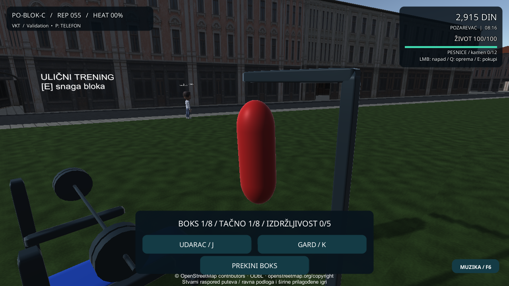

# Kontakti, srpska uvodna priča i reakcija vreće

Tri uvodna ugovora imaju srpske naslove i kontinuitet Mila → Kure → Luka. Brojevi ugovora, tri stanice, rokovi, nagrade i profil v9 ostaju postojeći. PRATI CILJ otvara pravi dnevnik i za kampanju; aktivna porudžbina iz šteka ulazi u postojeću činjenicu aktivne dostave. Svaki kontakt ima svoju autorsku repliku. Opcioni AI ostaje izvor teksta, a stvarni sistemi odlučuju cilj i isplatu.

Vreća visi na pivotu i dobija ograničeno prigušeno njihanje posle vrha prihvaćenog udarca. Koristi isti trening-sat, zamrzava se tokom pauze i vraća pri završetku/prekidu. To je kinematička reakcija na prihvaćen unos; geometrijski dodir pesnice, poravnanje igrača prema vreći i dinamička simulacija još nisu uvedeni.

RED slučajevi su odvojeno sačuvani za nedostajuću reakciju vreće, isti tekst kontakata, neotvaranje dnevnika i pogrešan savet tokom porudžbine. Završno: 92 ciljanih; ceo Unity skup 336 uspešnih, 0 neuspešnih, 1 preskočenih; Windows build i svih 11 native tokova izlaz 0. Native boks meri ugao, pauzu usred njihanja i završni reset; kontakt dugmetom otvara dnevnik bez izmene snapshot-a. Svi izvorni model asseti ostali su isti.

Native screenshot koristi kontrolisan kadar postojeće kamere. Nije dokaz fizičkog kontakta ili slobodne vožnje. Fizički telefoni, dugi FPS/termalni test, novi glasovi/AI film, vožnja/saobraćaj, novi 3D teren i deset autorskih misija nisu potvrđeni. Novi build je lokalni; javni ZIP je prethodno izdanje.

[Plan deset scenarija](Campaign-First10-20261103.md) | [Gemini/Copilot zadaci](External-AI-Tasks-20261103.md) | [Dokazi](Verification-Campaign-Bag-20261103.json)
