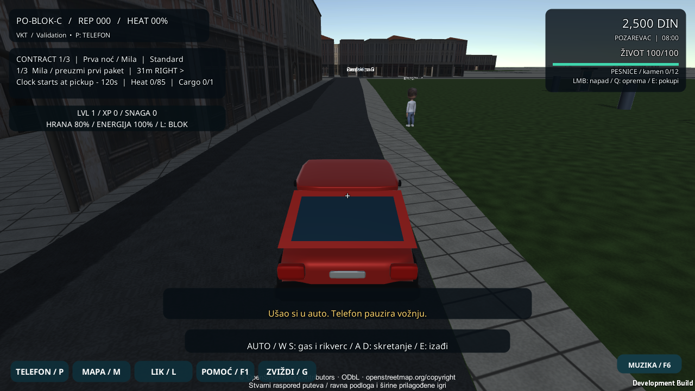

# Prvi parkirani auto u VKT-u

Crveni hečbek je na ulici **15. oktobra** u podrazumevanoj offline mapi. Posle špice početna poruka pokazuje smer i udaljenost. Priđi autu i pogledaj ga. Na Windowsu pritisni **E** za ulazak ili izlazak, **W/S** za gas i rikverc i **A/D** za skretanje. Na telefonu koristi **KORISTI** i četiri strelice. Telefon u igri pauzira vožnju.

Kretanje ostaje kod postojećeg vlasnika unosa. Kinematički auto proverava podlogu i prepreke, a izlaz redom proverava levo, desno i iza vozila. Ako nema mesta, igrač ostaje u autu. Po izlasku se vraća prethodni režim kamere i uključuje pešačka kolizija. Zapis statistike prima samo pređene metre. Pozicija i zauzetost auta pripadaju trenutnoj sesiji, a profil ostaje v10.

Ciljani Unity skup 58/58. Ceo skup 361 prošlo, 0 palo, 1 preskočen. Windows build i pet izvršnih provera završili su izlazom 0. Dva prolaza automobila obuhvataju početni ulazak, kratku vožnju u gradu, rikverc sa skretanjem, zid, pauzu, tri blokirana izlaza, slobodan izlaz i povratak kontrole. Deo sa kontrolisanim preprekama koristi izolovanu testnu podlogu i sintetički unos.

Zasebna Android QA aplikacija ima svoj identifikator paketa i odvojene podatke. Zabeležena je instalacija na fizičkom telefonu, uz potvrđeno prisustvo postojećeg VKT paketa. Automatizovani tok vožnje na uređaju je prošao sa sintetičkim Unity unosom. Sačuvan je snimak QA aplikacije sa fizičkog ekrana.

Za narednu proveru ostaju duža vožnja kroz grad, ručni test na uređaju, iOS i merenje performansi. AI saobraćaj i audio motora su naredne funkcije.

[Rezultati i fajlovi](Verification-First-Car-20261104.json)
