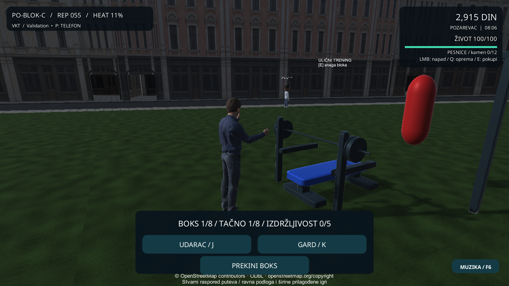

# Boks odabranog ljudskog lika

Sledeća povezana celina posle telefona i regionalne mape: odabrani MPFB lik ostaje vidljiv u bokserskom treningu, uključujući prvo lice. Prikazuje gard, desni jab i napor. Benč zadržava prethodni trening-model.

## Arhitektura i ponovno korišćenje

| Odgovornost | Postojeći vlasnik / veza |
| --- | --- |
| Runde, prozor reakcije, uspeh i zaštita isplate | `CityBoxingRun`, bez novog sata ili nagrade |
| Početak, unos, završetak i otkazivanje | `CityLifestyleRuntime` / `CityLifestyle` |
| Gard, prsti i položaj ruku | Postojeći `CityHumanPose`, `CityActorMotion.PoseBoxingArm`, `CityHumanHandPose` |
| Posmatranje sesije i prikaz napora | `CityHumanActor.BindBoxing`; ne poziva Tick/Respond/TryClaim |
| Vidljivost i postojeća kamera | `CityCameraRig`; ne stvara drugu kameru ili kontroler |

Ako ljudski rig nije odabran ili nema spremne šake/sesiju, ostaje prethodni prikaz. Pauza zadržava prikazanu pozu. Završetak vraća prethodnu perspektivu; u prvom licu se telo ponovo skriva. Izbor lika ostaje sesijski, profil v9 i asseti modela se ne menjaju.

## Prihvat

RED je reprodukovao nedostajuću vezu sa treningom: 25 uspešnih, 1 neuspešan ciljani test, Editor izlaz 2. Posle povezivanja prvi ciljani skup ima 26/26. Test nad pravim modelom proverava zatvaranje prstiju, pomeranje šake u udarcu, zamrznutu pozu/sat pri pauzi, blokiran telefonski hvat tokom garda i oslobađanje poze nakon otkazivanja.

Razvojna native provera bira lik kroz garderober, pokreće boks, proverava skriven original, gard/pauzu/udarac, odgovara na osam rundi kroz postojeći input i proverava jednu isplatu. Poslednji frejm završenog treninga proverava se kao povratak iz treninga, odvojeno od aktivne poze.

**Završni prihvat: 46/46 ciljanih; 323 uspešna testa, 0 neuspešnih, 1 opcioni preskočen; Windows build i 11 native tokova sa izlazom 0.** [Rezultati](Verification-Human-Boxing-20261102.json) | [Manifest](Human-Boxing-Identity-20261102.json). Prethodna upakovana Windows verzija je i dalje izdanje telefon/boks/reljef; novi lokalni build nije automatski novo GitHub izdanje.

## Sledeći potezi

1. Benč ljudskog modela, kalibracija hvata šipke i stopala.
2. Dodatni položaji boksa, rad nogu i precizniji kontakt sa vrećom.
3. Proverene visine ulica, usklađen 3D put i kolizije.
4. Prepoznatljiv centar Požarevca.
5. Srpski glasovi i ulični audio miks.
6. Povezane misije, kontakti i policijske posledice.

Nezavisan read-only pregled potvrdio je ponovno korišćenje postojećih vlasnika i zatvaranje nalaza završnog frejma. Izvršne provere pokrenuo je glavni agent. Fizički Android/iPhone, duži FPS/termalni test, estetski prihvat, prevoz tokom treninga i novi benč-rig nisu potvrđeni. Nisu dodati novi glasovi, AI film ili 3D teren.
