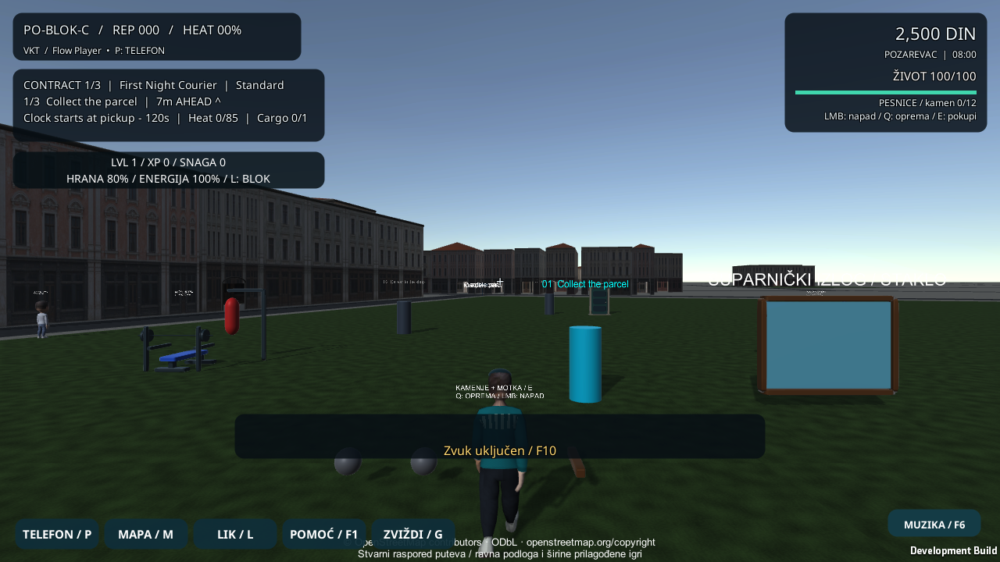

# Hod: koordinacija, smirivanje i povratak posle teleporta

## Početno stanje i dokazi

Provera u stvarnom Windows programu, pre izmene `CityActorMotion`, našla je 33 merljiva uzorka u kojima ruke prate svoje noge. Svih 33 bilo je pogrešno upareno. Druga nova provera pokazala je da veliki skok položaja ne poništava odmah prividnu brzinu animacije. Ostale provere tog probnog prolaza nisu prijavile grešku.

Izvor problema: isti sinus je pomerao levu ruku i levu nogu unapred. Kod velikog pomeranja merena brzina jeste postajala nula, ali je prethodna brzina ostajala u zaglađivanju; faza koraka i okretanje modela i dalje su koristili ceo skok položaja.

## Implementacija i vlasništvo

- `CityGaitState` je mali posmatrač animacije. Iz horizontalnog pomeranja računa fazu koraka, zaglađenu brzinu i težinu poze. Ne pomera igrača i ne poseduje sudare, život, izdržljivost, novac ili misije.
- Leva ruka prati desnu nogu, desna levu. Pri stajanju težina poze postepeno pada; faza se bez pređenog puta ne pomera.
- Pomeranje veće od 5 m u jednom uzorku smatra se prekidom kontinuiteta prikaza. Brzina, faza i težina poze se poništavaju, bira se mirna animacija, a model se ne okreće ka vektoru teleporta. To je zaštita prikaza, ne ograničenje putovanja igrača.
- `CityActorMotion` i dalje poseduje vezivanje kostiju i saradnju sa postojećim klipovima. Čuva osnovne i završne rotacije deset zglobova, uklanja svoj dodatak pre sledećeg uzorkovanja i zadržava završne rotacije tokom pauze. Isključivanje komponente vraća osnovu i poništava stanje hoda.
- Pauza se prepoznaje i preko trenutnog `Time.timeScale`. Unity u kadru otvaranja telefona može još da ima pozitivno prethodno `deltaTime`; samo provera tog trajanja dozvoljavala je jedan neželjen pomak poze. Nova provera taj kadar takođe zaustavlja.
- Postojeći kontroler igrača, kamere, benč, boks, statistika i profil v9 ostaju u svojim ulogama. Nema novog paketa niti dodatnog pravljenja nizova/modela u svakom kadru; nizovi su napravljeni pri inicijalizaciji. Dugotrajno profilisanje nije rađeno.

## Provere

Osam novih testova proverava suprotno uparivanje udova, jednaku fazu pri 30 i 60 vremenskih koraka u sekundi za istu putanju, postepeno smirivanje bez dodatnog puta, pauzu, teleport, vertikalno pomeranje, nevažeće uzorke i ponovljeno poništavanje stanja.

Puna provera: **231 uspešan test, 0 neuspešnih, 1 preskočen** (232 ukupno).

Preskočen je postojeći test opcionog ArcGIS renderovanja, jer ArcGIS nije deo prenosivog izvora. Windows build: **izlaz 0, 0 grešaka**. Završni desktop i touch-preview prolazi: **izlaz 0, sve obavezne provere uspešne, bez prijavljenih izuzetaka iz proveravanih kategorija**. Desktop prolaz je izmerio 24 upotrebljiva para udova, 0 pogrešnih i 0° promene oba kolena pri pauzi. Benč je prošao osam ponavljanja i 926 merenih kadrova kontakta. Raspored za dodir proveren je u Windows programu; fizički telefon nije korišćen.

Windows razvojna provera meri pravce stvarno prikazanih nadlaktica i butina posle animiranja, čuva rotacije pri pauzi, proverava smirivanje posle puštanja komandi i poništavanje po teleportskoj probi. U istom prolazu ostaju provere telefona, mape, muzike, statistike, benča i porudžbina. Sintetičke komande i probni profil nisu zamena za ljudski obilazak grada ili fizički uređaj. Završni ishodi su u [izveštaju provera](Verification-Locomotion-20261021.json).

Ponovljive komande iz korena projekta, uz odgovarajuće putanje i nove izlazne foldere:

```bat
"C:\Program Files\Unity\Hub\Editor\6000.6.5f1\Editor\Unity.exe" -batchmode -nographics -buildTarget Win64 -job-worker-count 4 -projectPath . -runTests -testPlatform EditMode -testResults "C:\VKT-Evidence\tests.xml" -logFile "C:\VKT-Evidence\tests.log"
python Tools\Test-StreetSound.py --player "C:\VKT-Build\VKT.exe" --output "C:\VKT-Evidence\desktop"
python Tools\Test-StreetSound.py --player "C:\VKT-Build\VKT.exe" --output "C:\VKT-Evidence\touch-preview" --touch-preview
git diff --check
```



## Granice i naredni potezi

Ovo je proceduralna dorada postojećeg stilizovanog modela. Nisu dodati novi humanoidni model, kontakt stopala sa proizvoljnim terenom, animacija pada, hvat prstiju, nova mimika ili novi srpski snimci. Vreme hoda je vezano za pređeni put; brzine kretanja i balans misija nisu menjani. Fizički Android/iPhone i dugotrajne performanse ostaju odvojene provere.

1. Oslonac stopala na nagibima, ivičnjacima i stepenicama.
2. Ručni zglobovi i hvat šipke, zatim gard i reakcije u boksu.
3. Skejt: pomeranje, skok, preuzimanje i bezbedan silazak.
4. Vidljivi pešaci, izbegavanje prepreka i mini-mapa sa svim ciljevima.
5. Jedan prepoznatljiv centralni blok, provereni reljef i usklađivanje koraka sa podlogom/zvukom.
