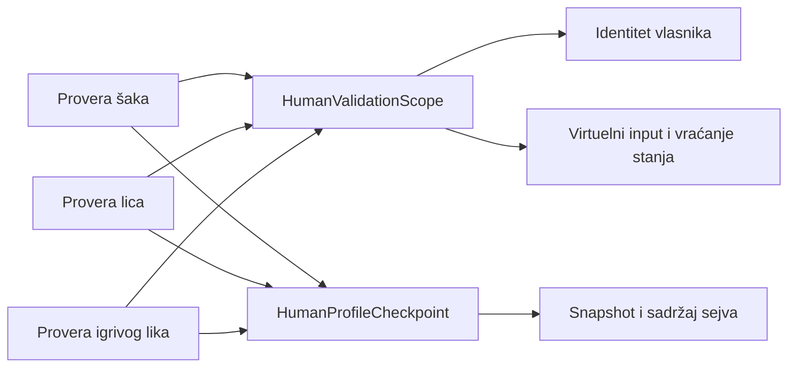

# Zajednički okvir native provera — dovršetak 2. novembra 2026.

## Obim i prihvat

Korisnik je iz arhitektonskog pregleda izabrao zajednički okvir native provera. Refaktor obuhvata razvojne Windows scenarije šaka, lica i igrivog lika. Njihove posebne provere deformacija, garda, stvarnog napada, hoda, kamera, trening-fallback-a, pauze, ekonomije i kontrole ostaju u odgovarajućim scenarijima. Postojeći Python CLI argumenti, JSON polja, nazivi slika i log markeri ostaju isti.

**Završni prihvat 2. novembra:** 8/8 ciljanih testova; ceo Unity skup 300 uspešnih, 0 neuspešnih, 1 opcioni ArcGIS preskočen. Windows build, četiri ljudska native scenarija, desktop/touch-preview i prirodan završetak/preskakanje prethodne špice imaju izlaz 0. [Mašinska evidencija](Verification-Native-Fixture-20261102.json) i [manifest ulaza/runtime-a](Native-Fixture-Identity-20261102.json) čuvaju rezultate i razdvajaju ih od fizičkog telefona i ljudske estetske potvrde.

## Zajednički modul i stvarni seam

`CityPlayerValidation.HumanFixture.cs` koncentriše zajednički lifecycle. Njegov interface ostaje privatan postojećem verifikacionom modulu: `HumanValidationScope`, `HumanProfileCheckpoint` i deljeni pristup dugmadima, telu i tasterima. Tri stvarna scenarija koriste isti seam; nije uveden novi adapter za hipotetički engine ili javni gameplay interface.

Depth dolazi iz jedinstvenog životnog veka: jedan scope preuzima odgovornost za vlasništvo virtuelne tastature i vraćanje stanja pri normalnom ili ranom izlazu. Locality drži zajedničku pripremu i teardown u jednom fajlu; leverage se dobija kroz tri postojeća native pozivaoca. Deletion test: uklanjanje fixture-a vratilo bi duplirane owner/input/profile obaveze u sva tri scenarija. Za morfove, prste i fizički hod nije uvedena generička hijerarhija.

## Ispravke tokom refaktora

- Stari `PreviewProfileSignature` nulirao je satove u prosleđenom snapshot-u. Sada prvo pravi nezavisnu kopiju. Test poredi ceo originalni JSON pre i posle poziva.
- Vlasništvo se proverava po identitetu objekata. Zamena jedne kamere drugom pri istom ukupnom broju sada pada na proveri. Uključeni su neaktivni objekti.
- Jedan scope pravi najviše jednu virtuelnu tastaturu i uklanja samo nju. Duplo zatvaranje je bezbedno; novo traženje tastature posle zatvaranja se odbija.
- Zajednički teardown vraća omogućeno/onemogućeno kretanje i kursor, a pogled neutralizuje kroz postojeći `ResetView()`. Time kamera i unutrašnji nagib kontrolera ostaju usklađeni. Ne vraća prethodni nenulti nagib. Zdravlje, privremena podloga i bake mesh ostaju obaveze scenarija koji ih menjaju, uz `finally` koji uvek oslobađa scope.

Bootstrap i dalje pravi izolovan privremeni profil. Fixture ne briše fajlove i ne dodiruje lične profile. Baštenski UTC napredak ostaje dozvoljen u semantičkom poređenju; neposredan izbor lika dodatno zahteva identične bajtove prethodno sačuvanog profila. Profil ostaje v9.

## Dokazi u toku rada

RED skup je imao 1 uspešan i 7 neuspešnih slučajeva, proces 2. Jedan je neposredno reprodukovao mutiranje postojećeg snapshot-a; šest je prijavilo odsustvo zajedničkog scope-a. Posle implementacije ciljani skup ima 8/8 uspešnih, 0 neuspešnih, proces 0. Testovi koriste stvarne Unity objekte i stvarni Input System, bez zamenskog kontrolera ili tastature.

Zajednički okvir je razvojna infrastruktura. Sam ne poboljšava izgled, animaciju ili sadržaj igre. Fizičko držanje telefona, novi trening-rig, teren, srpski glasovi i nova AI špica ostaju naredni gameplay rad. Fizički mobilni test, dug FPS/termalni test i korisnikova estetska potvrda ostaju odvojeni dokazi.

[Rečnik projekta](../CONTEXT.md), [prethodna ispravka telefona](Phone-Screens-20261101.md) i [šake/gard/udarac](Human-Hands-20261101.md) ostaju kontekst.

## Nezavisan pregled i ponovljeni prihvat

Nezavisan pregled je otkrio da vraćanje quaternion-a posle `ResetView()` ostavlja kameru neusaglašenu sa privatnim pitch stanjem kontrolera. Izabran je precizan ugovor neutralizacije pogleda. Drugi RED skup reprodukovao je dve neuspešne varijante sa zaostalim nagibom 14,414°. Scope sada ima samo kontroler kao ulaz, a `ResetView()` je jedini reset pogleda. Test pre zatvaranja postavlja drugi nenulti nagib od -25°, tako da otkriva i buduće uklanjanje reseta. Pregled potvrđuje da su nalaz i rupa testa zatvoreni; izvršne provere je pokrenuo glavni agent.

Jedan od pokušaja nije stigao do testova: Unity shader compiler je prijavio premali Windows paging file i proces je završio kodom 1073741845. Taj pad je sačuvan kao infrastrukturni neuspeh, bez predstavljanja kao RED dokaz. Završne Editor provere koriste dokumentovani `-diag-debug-shader-compiler` režim sa jednom instancom shader compilera. [Unity dokumentacija](https://docs.unity.com/en-us/engine/6000.0/manual/unity-editor/command-line-arguments/editor). Windows sistemska podešavanja nisu menjana.

Statička provera je potvrdila nepromenjena report polja, izlazna imena i dodele metrika: lice 31, šake 20, igrivi lik 39. Svih 51 fajlova ljudskog modela ostalo je identično. Nema novih biblioteka, promena paketa, scene, profila v9 ili običnog gameplay toka.

Pregled isporuke je dodatno zatvorio dve rupe u dokazima: manifest izvora sada se beleži pre završnih testova i builda, a svih runtime fajlova pre native tokova. Izvor i runtime moraju ostati identični tokom tih tokova. U finalizaciji se posebno beleže samo proverena Unity normalizacija metapodataka/podešavanja i dokumenti/pokretač dodati paketu; C# i sadržaj runtime-a nemaju izuzeće. Ceo runtime manifest ponovo se proverava u ZIP-u i pre isporuke.

## Sledeći gameplay koraci

1. Telefon u ruci i precizan hvat, uz prikazni sat tokom pauze.
2. Benč i boks novog ljudskog riga, sa kontaktom šaka i stopala.
3. Kosine, stepenice i proverene visine terena.
4. Prepoznatljiv centralni blok Požarevca.
5. Srpski glasovi, vizemi i ambijentalni miks.
6. Povezane misije, NPC reakcije i policijske posledice.
