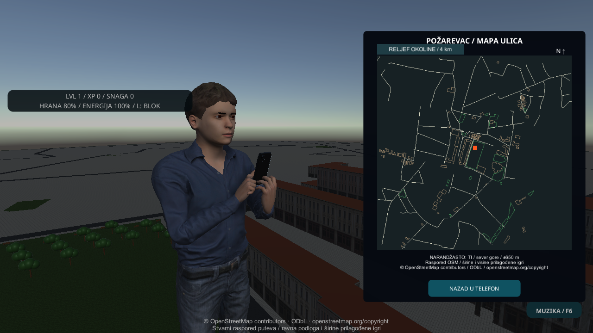
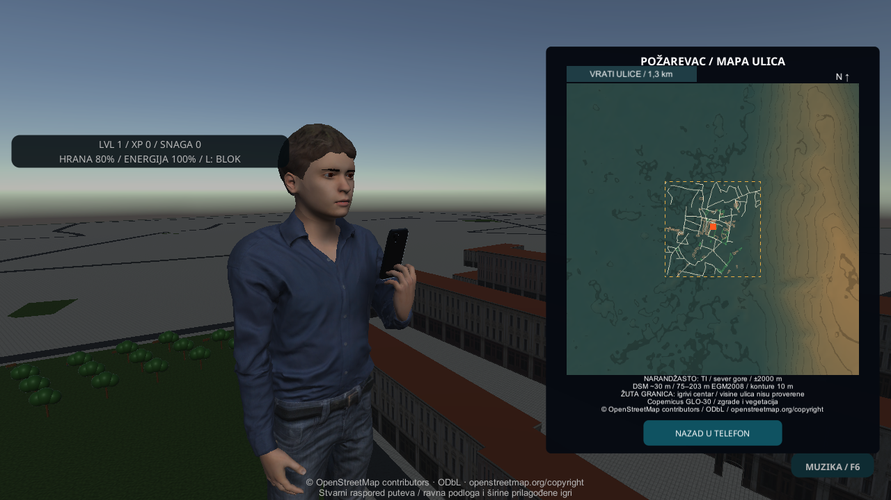
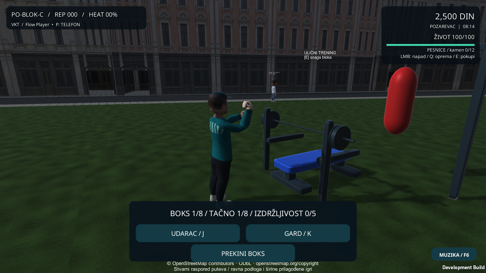

# Telefon u ruci, bokserski zglobovi i reljef Požarevca

Ovaj korak povezuje fizički telefon novog ljudskog lika, stvarne dugmiće telefona i pregled šireg reljefa. Windows je primarni cilj. Završni prihvat: **40/40 ciljanih testova; ceo Unity skup 322 uspešna, 0 neuspešnih, 1 opcioni ArcGIS preskočen; Windows build i 11 native tokova sa izlazom 0.** [Mašinski rezultati](Verification-Phone-Boxing-Relief-20261102.json) | [manifest izvora i runtime-a](Phone-Boxing-Relief-Identity-20261102.json).

## Kako probati

Izaberi `L → garderober → NOVI 3D LIK / PREGLED → IGRAJ U GRADU`. Otvori telefon na `P`; na širokom ekranu lik podiže telefon levom rukom. Klik na dugme pokreće dodir desnim kažiprstom. Igra ostaje pauzirana dok prikaz ruku koristi zaseban prikazni sat. `Esc` zatvara telefon i vraća pogled/kontrolu.

`M` ili `P → MAPA` otvara ulice centra. `RELJEF OKOLINE / 4 km` menja mapu u regionalni pregled ±2 km; isto dugme vraća detaljnije ulice ±650 m. Narandžasti marker i sever koriste isti centar. Isprekidana žuta granica označava postojeći igrivi centar. Mapa ne otključava putovanje u okolinu.

Za stari lik, uspravan uzak ekran, trening, prevoz, aktivan udarac ili prepreku ispred kamere ostaje običan telefonski ekran. Model, kolizije i kamera imaju postojećeg vlasnika; telefon ne dodaje drugi kontroler, kameru ili audio listener. Skala novog ljudskog modela je postojeća normalizovana skala; dinamičko/neuniformno skaliranje nije prihvaćeno ovim korakom.

## Ispravka boksa

Prethodno usmeravanje pesnice održavalo je uzdužnu osu, ali je moglo da prenese gotovo ceo axial roll na zglob. RED test je izmerio 167,179° uvrtanja obe šake u gardu pri snazi 0 i 5. `CityHandPose.AlignForearmRoll` sada prenosi tu rotaciju na podlakticu pre zatvaranja prstiju. Novi test proverava palac nagore, potpisan dlan prema telu, ceo put gard–jab–gard i relativno uvrtanje manje od 60°. Benč koristi svoj postojeći hvat. Benč i boks i dalje koriste prethodni Kenney trening-rig; novi ljudski trening-rig je zaseban sledeći korak.

Telefon zasebno kalibriše osu kažiprsta i vrh prsta. Šest ograničenih IK koraka poravnava prst sa podlakticom uz kontakt sa ekranom; proverava se dodir ispod 12 mm i ugao prsta/podlaktice ispod 65° tokom kontakta. To su kinematički endpoint pokazatelji, ne simulacija deformacije kože pri dodiru.

## Podaci o reljefu

Korišćen je postojeći N44 E021 Copernicus GLO-30 raster iz lokalnog VKT toolchain-a. Nisu instalirane nove biblioteke niti potrebni nalog ili API ključ. [Zvanični AWS katalog](https://registry.opendata.aws/copernicus-dem/) opisuje besplatan DSM, uključujući objekte i vegetaciju, izdanje 2021. [Izvorni TIFF](https://copernicus-dem-30m.s3.amazonaws.com/Copernicus_DSM_COG_10_N44_00_E021_00_DEM/Copernicus_DSM_COG_10_N44_00_E021_00_DEM.tif).

- Izvorni SHA-256: `6f5c32e9f763f40446810257aa2140697ed504f054ec3e846cfb302cd9a82314`; 44.745.977 B; EPSG:4326; 3600²; korak 1 lučna sekunda; EGM2008.
- Centar: 44.6199926° N, 21.1854° E, potpuno isti kao postojeći OSM uvoz. Obrnuta postojeća lokalna projekcija: `lat=anchorLat+z/111320`; `lon=anchorLon+x/(111320*cos(anchorLat))`.
- Izvoz: 129² uzoraka u ±2 km, redovi od juga ka severu, 31,25 m lokalni korak. Bilinearna interpolacija koristi stvarni affine rastera i centre piksela, bez pretpostavke o ivicama pločice. Izvedeni opseg je 74,75–203,45 m DSM. Konture od 10 m su vizuelna pomoć iz interpoliranog DSM-a.
- [Izvozni alat](../Tools/Maps/export_relief.py) odbija pogrešan hash, nevažeći centar, izlazak iz rastera i nodata. [Testovi izvoza](../Tools/Maps/test_export_relief.py) proveravaju stvarni geografski smer, interpolaciju i odbijanje loših ulaza. Unity proverava metapodatke, centar, dimenzije i konačne vrednosti, zatim čuva sopstveni snapshot.
- Ovo je **podloga mape**, ne potvrđena visina ulice niti čisti model tla. Prethodni [audit visina](Elevation-Audit-20261018.json) ostaje nepromenjen i ne uključuje runtime teren. Putevi, ravni pod, sudari, zgrade, misijske stanice i spawn nisu pomerani.

## Licenca reljefa

[Potpuna zvanična licenca](Copernicus-DEM-GLO30-License.pdf) | [izvor licence](https://documentation.dataspace.copernicus.eu/APIs/SentinelHub/Data/DEM/resources/license/License-COPDEM-30.pdf) | [sve licence projekta](../THIRD_PARTY_NOTICES.md).

produced using Copernicus WorldDEM-30 © DLR e.V. 2010-2014 and © Airbus Defence and Space GmbH 2014-2018 provided under COPERNICUS by the European Union and ESA; all rights reserved.

The organisations in charge of the Copernicus programme by law or by delegation do not incur any liability for any use of the Copernicus WorldDEM-30.

Ovaj projekat nije zvanično podržan od navedenih organizacija. Dalja distribucija izvedenih podataka mora očuvati obaveštenja i obaveze iz člana 6. Ovo nije CC0 raster. OSM zadržava zasebnu ODbL atribuciju.

## Sledeći koraci

1. Novi ljudski trening-rig sa proverom kontakta šake, šipke, rukavice i poda.
2. Geografski proverene kontrolne tačke ulica, filtriranje DSM-a i probna 3D padina sa usklađenim putem i sudarima.
3. Prepoznatljiv centralni blok, park i kvalitetnije fasade uz ograničen budžet geometrije.
4. Prirodni srpski glasovi, vizemi i miks saobraćaja/ulice.
5. Povezane misije, kontakti i policijske posledice.
6. Fizički Android/iPhone, duži Windows prolazak i merenje FPS-a/temperature.

## Sveži prikazi i granice prihvata

Telefonski kadrovi nastali su u kontrolisanoj native fixture sa platformom iznad grada, radi izolovanja prepreka kamere; nisu dokaz rada na fizičkom telefonu ni stvarnog 3D reljefa.

Oba native desktop/touch-preview toka završavaju boks, povratak kontrole i jednu isplatu. Izveštaji uključuju stvarno prikazani axial twist. Fizički Android/iPhone, duži FPS/termalni prolazak i ljudska estetska potvrda ostaju neprovereni. Novi glasovi/AI film i novi ljudski trening-rig nisu dodati. Prethodna uvodna remontaža prolazi prirodan završetak i preskakanje.

Nezavisan pregled je zatvorio Unity destroyed-panel teardown, vidljivu OSM atribuciju u oba režima i profil-checkpoint ugovor. Poređenje profila obavlja se neposredno oko UI operacija, bez mešanja legitimnog autosave/gameplay napretka; tap mora uspeti u sva tri camera moda. Prethodni prototip/pokušaji sa zaustavljenim source manifestom ostali su odvojeni od konačnog r3 prihvata.
