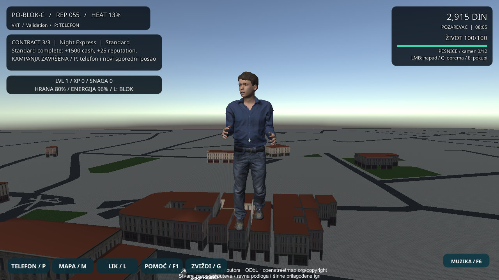
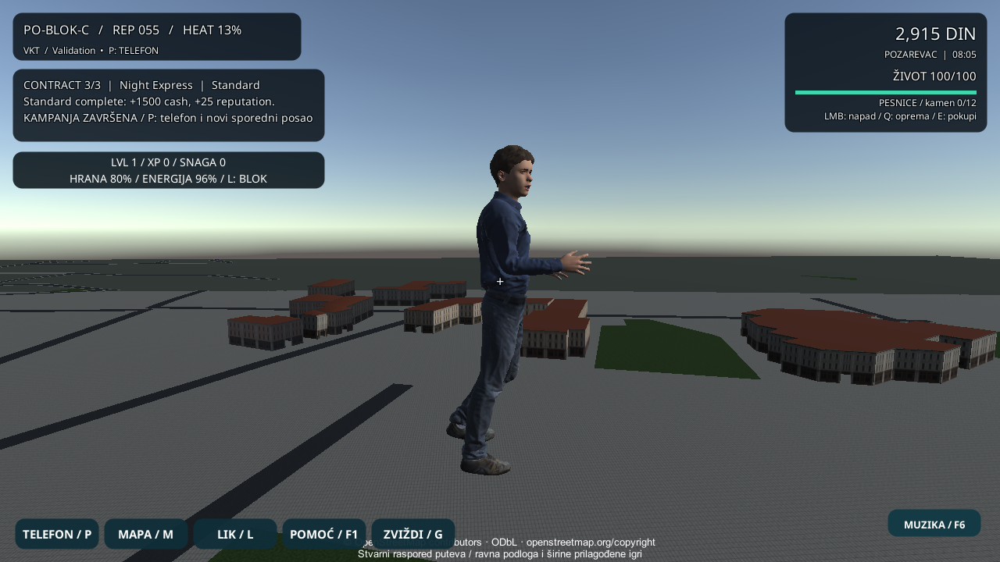
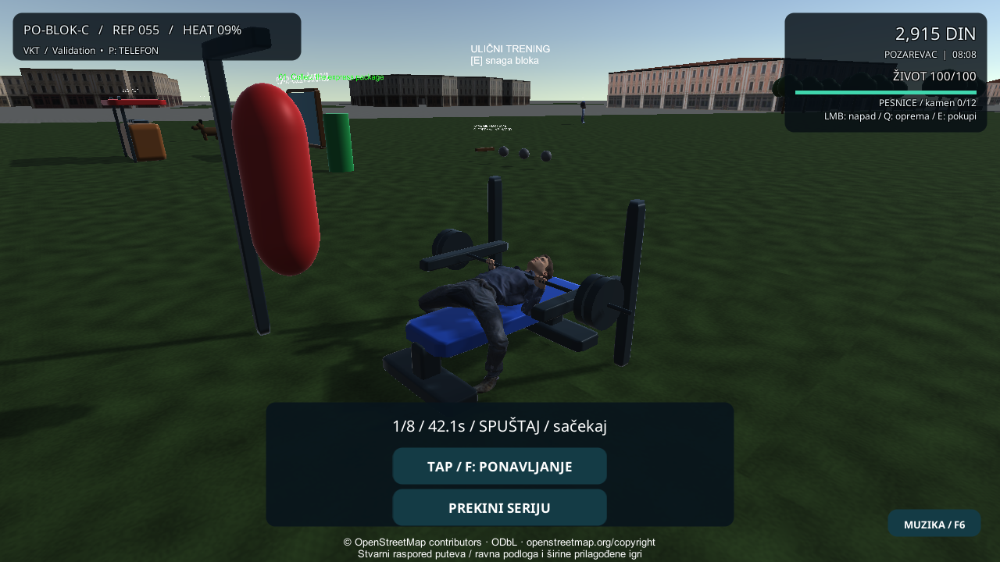

# Ruke pri sprintu i benč odabranog ljudskog lika

Aktivni izvor je premesten u `C:/Users/jamal/Documents/VKT-3D-PO-BLOK-C/VKT-PozarevacCity`; početni commit je 5336f81, bez početnih lokalnih izmena.

## Promena i arhitektura

`CityGaitState.RunningBlend` dolazi iz posmatrane brzine i težine hoda. I legacy i MPFB koriste isti `RelaxArm`; pri sprintu podlaktice prelaze u savijen položaj umesto spuštanja uz telo. Faza i suprotan rad ruke/noge ostaju zasnovani na pređenom putu, bez novog inputa ili kretanja.

Benč dobija jedan keširan MPFB prikaz kroz postojeći validator skeleta. Šipka, trening-sat, ponavljanja, kontrola i nagrade ostaju postojeći. Deset prstiju koristi kalibrisane uglove i kontakt za 32 mm šipku. Stopala se proveravaju i kroz baked verteks obuće, tlo i metalne oslonce; hvat, pregib zgloba i dužine segmenata imaju zasebne provere. Izbor starog lika zadržava prethodni prikaz. Uvezene teksture/materijali i 51 fajl modela ostali su identični. Profil je v9.

## Provere

RED je izmerio samo 20,902° pregiba lakta tokom sprinta; popravka prolazi 70–110° na obe ruke kroz više ciklusa, suprotne faze i očuvane dužine. Odvojeni RED slučajevi otkrili su nedostajuću bench vezu, FeetReady proveru pre početka treninga, prste predaleko od šipke i obuću preblizu StableFoot osloncu. To su ispravljeni slučajevi; kontakti prstiju su geometrijski pokazatelji skeleta, ne soft-body simulacija kože.

**Završno: 54/54 ciljanih; ceo Unity skup 326 uspešnih, 0 neuspešnih, 1 opcioni ArcGIS preskočen; Windows build i 11 native tokova izlaz 0.** [Rezultati](Verification-Running-Bench-20261103.json) | [Manifest](Running-Bench-Identity-20261103.json).

Prvi pokušaj nije stigao do testova: URP AssetImportWorker je pao pri ponovnom uvozu. Sačuvan je kao infrastrukturni neuspeh, ne RED. Završne provere koriste dokumentovani jednokratni `-refreshImportMode InProcess`, bez brisanja Library ili promene sistemskih podešavanja. [Unity 6000.6 dokumentacija](https://docs.unity.com/en-us/engine/6000.6/manual/unity-editor/command-line-arguments/editor#asset-import-arguments).

Native sprint koristi kontrolisanu ravnu platformu iznad grada; to nije test proizvoljnih 3D padina. Native benč proverava osam ponavljanja, pauzu i jednu isplatu, uz postojeći poseban challenge bonus kada je legitiman. Isti tok zatim proverava osam bokserskih rundi. Nezavisni read-only pregledi proverili su geometriju i granice vlasništva; izvršne provere pokrenuo je glavni agent.

## Gemini kopija

[Odvojeni audit](Gemini-Intake-Review-20261103.md) dokumentuje zašto se React/Three.js rewrite ne prepisuje preko Unity-ja. Iz tog ZIP-a nije uvezen runtime kod, rig, sejv, muzika ili video. Uzet je plan bezbednog izdvajanja ideja. ZIP ostaje van repozitorijuma.

## Granice i naredni rad

Fizički Android/iPhone, dug FPS/termalni test, ljudska estetska potvrda, proizvoljna skala klupe i prevoz tokom treninga nisu potvrđeni. Novi javni ZIP, glasovi, AI film, centar i 3D teren nisu deo ovog koraka.

1. Precizniji kontakt sa vrećom i bokserski rad nogu.
2. Proverene 3D visine, putevi i kolizije.
3. Prepoznatljiv centralni blok Požarevca.
4. Srpski glasovi i ulični miks.
5. Povezane misije i NPC/policijske reakcije.
6. Fizički telefoni i duži test performansi.
