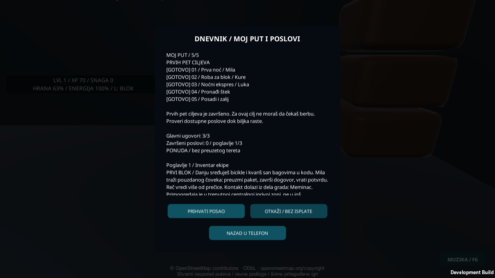
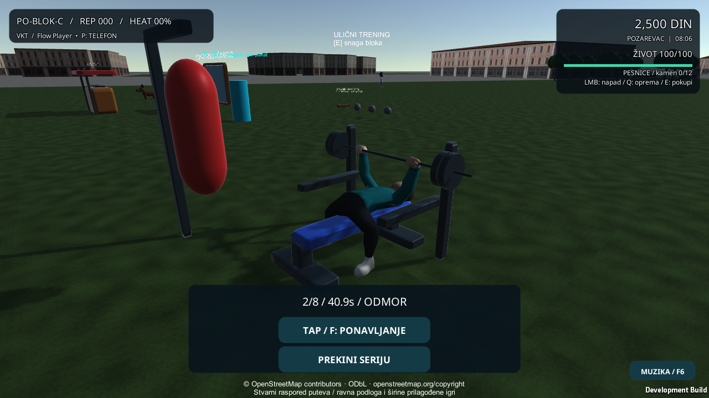

# Prvih pet ciljeva i benč

Otvori telefon tasterom P, zatim **DNEVNIK / POSLOVI**. Tri početna ugovora čine prva tri cilja. Četvrti se beleži ulaskom kroz vrata šteka kod trećeg markera. Za peti cilj kupi seme na pultu i posadi ga u praznu saksiju. Pritisni E ponovo da zaliješ. Štek se otključava posle prvog ugovora i možeš ga posetiti pre završetka trećeg. Nagrade ostaju vezane za postojeće ugovore i poslove.

Profil v10 čuva posetu i prvo zalivanje. Raniji profili kreću bez te dve zabeležene radnje. Aktivni ulični posao ili porudžbina imaju prednost u dnevniku da rok ostane pri vrhu.

Početni lik koristi Kenney rig, a opcioni teksas lik koristi RodjaHuman. Jastuk je sužen sa 56 na 34 cm, uz zadržanu visinu oslonca i položaj trupa. Početni lik ima kraći položaj stopala i bočno usmereno savijanje kolena. Hvat, šipka, faze ponavljanja i nagrade koriste postojeću logiku. Regresija peče geometriju nogu i obuće na tri visine šipke, pri dva ugla klupe i dva nivoa snage. Stara poza je imala 50 odnosno 48 verteksa dublje od 5 mm u collider-u klupe. Zabeleženo je nula takvih verteksa i oba đona kod poda u svih šest uzoraka.

Ciljani Unity skup 156/0/0. Ceo skup 355/0/1. Windows build i 11 provera pokrenute igre završili su izlazom 0. Dnevnik prikazuje 5/5 i počinje od vrha. Test šteka koristi stvarne interakcije vrata, pulta i saksije, uz kontrolisano pozicioniranje igrača. Učitavanje ponovo čita datoteku u nov model napretka. Ljudski i početni lik prolaze zasebne provere benča. Svi distribuirani modeli zadržali su iste heševe.

Prvi pokušaj Windows provere tražio je Text pod imenom omotača dnevnika. Izmenjeni test proverava stvarni sadržaj aktivnog ScrollRect-a i njegovo početno skrolovanje.

Fizički Android/iPhone, samostalno prelaženje cele rute i dug test performansi ostaju za posebnu proveru. Ovaj build je lokalni.

[Dokaz provera](Verification-Starter-Bench-20261104.json) · [Spoljna provera](External-AI-Review-20261104.md) · [Plan prvih deset scenarija](Campaign-First10-20261103.md)
