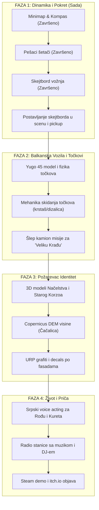

# 🚀 VKT / Velika Krađa Točkova — Master Blueprint za Nadogradnju Projekta

> **Dokument:** Master plan arhitekture, preporučenih modela, biblioteka, alata i mehanika za postizanje svetskog indie nivoa ("Game Changer").  
> **Lokacija:** Požarevac, Srbija  
> **Ciljna platforma:** PC (Windows / Steam / itch.io) + Optimizovani Android port  
> **Engine:** Unity 6000.6 (URP)

---

## 🏛️ 1. Vizuelni Identitet i 3D Aspekt (Modeli, Rigovi, Svet)

### A. Autentični Požarevački Orijentiri (Landmarks)
Trenutni proceduralni OSM blokovi su odličan temelj. Da bi igra imala prepoznatljiv duh grada, potrebni su ručno modelovani "Hero" objekti:
1. **Zgrada Načelstva (Gradski park):** Masivna istorijska fasada, fontane, klupe i spomenik Milošu Obrenoviću.
2. **Stari Korzo & Tabačka čaršija:** Karakteristične fasade sa radnjama u prizemlju, baštama kafića i uličnim svetiljkama.
3. **Po-Blok C (Hideout zona):** Tipični socrealistički soliteri sa betonskim platoima, grafitima i podzemnim podrumima/štekovima.
4. **Čačalica i Hipodrom:** Park-šuma sa memorijalnim spomenikom i hipodromski prostor kao otvorena zona za vožnju.

### B. Karakteri i Animacije
* **Preporučeni alati:**
  * **Blender 4.5+:** Za izradu odeće (trenirke, kožne jakne, duksevi sa kapuljačom) i retopologiju.
  * **Mixamo + Unity Humanoid Rig:** Mapiranje 100+ standardnih uličnih animacija (šetnja, trčanje, naslanjanje na zid, pretnje, boks, sedenje na klupi).
  * **Blendshapes za lice:** 8 osnovnih morfa (treptaj, osmeh, bes, govor - otvorena usta za samoglasnike).
* **Decal sistem za ulične grafite:**
  * Iskoristiti URP Decal Projectors za autentične lokalne natpise ("Požarevac", grafiti navijačkih grupa, ulični tagovi, tragovi guma i pukotine na asfaltu).

---

## 🚗 2. Saobraćaj i Vozni Park (Balkanski Klasici)

Umesto generičkih automobila, uvesti domaće kultne modele koji odmah prave humor i atmosferu:

| Vozilo | Tip | Uloga u igri |
|---|---|---|
| **Yugo 45 / Koral In** | Hečbek | Prvi auto koji igrač može da kupi ili popravi. Brz u krivinama, ali nepouzdan. |
| **Golf II (Dizel)** | Hečbek | Izuzetno izdržljiv, dimi pri davanju gasa (particle dim). |
| **Zastava 101 (Stojadin)** | Karavan | Radno vozilo, odlično za prevoz točkova i robe. |
| **Dacia Duster / Škoda Rapid** | Patrolno vozilo | Policijska potera sa svetlima i autentičnom sirenom. |
| **FAP / TAM Kamiončić (Šlep)** | Teretno | Krajnji cilj kampanje — šlep služba za "Veliku Krađu Točkova"! |

### 🛠️ "Velika Krađa Točkova" — Ključna Unikatna Mehanika
* **Krađa točkova na ulici:**
  * Mini-igra sa dizalicom i krstašem: odvrnuti 4 šrafa pre nego što prođe pešak ili patrola.
  * Postavljanje cigli/panjeva umesto točkova.
  * Točak se nosi u ruci ili tovari u gepek/kolica i nosi na "otpad" ili prodaje Kuretu.

---

## 🎧 3. Audio Inženjering i Glasovi (Balkanski Vibe)

### A. Glasovna Gluma (Voice Acting)
* **Lokalni akcenti i sleng:** Čak i 30 kratkih audio snimaka po liku podiže imerziju za 500%:
  * *Rođa:* "Brate, jesi doneo ono? Nemoj da me zezaš, patrola kruži oko parka."
  * *Kuret:* "Alo bre, šta se guraš? 'Oćeš da ti skinem felne?!"
  * *Policajac:* "Stoj! Ruke na haubu!"
* **Alati:** Snimanje lokalnih glasova + Audacity/Reaper za mastering (dodavanje radio distorzije, walkie-talkie efekta).

### B. In-Game Radio Stanice
Implementirati radio u autu i u telefonu:
1. **Radio Po-Blok (98.2 MHz):** Domaći hip-hop, trap i beatovi.
2. **Morava Narodni (104.5 MHz):** Stari narodnjaci i ulični evergreeni.
3. **Kafana Chill (89.0 MHz):** Instrumentalni downtempo i lo-fi za štek.
* **DJ najave:** Kratki duhoviti komentari o stanju na putevima u Požarevcu između pesama.

### C. FMOD / Unity Dynamic Audio Snapshots
* Kada HEAT skoči na preko 50%: muzika dodaje agresivne bas linije i bubnjeve.
* Prilikom ulaska u zgradu/štek: low-pass filter (muzika sa ulice postaje prigušena).

---

## 📦 4. Preporučeni Unity Paketi i Biblioteke

| Paket / Biblioteka | Svrha | Gde preuzeti / Kako dodati |
|---|---|---|
| **Unity AI Navigation (`com.unity.ai.navigation`)** | Napredni NavMesh za trotoare i automobile | Unity Package Manager |
| **Unity Cinemachine (`com.unity.cinemachine`)** | Dinamičke kamere pri vožnji, trčanju i rez-scenama | Unity Package Manager |
| **Unity Splines (`com.unity.splines`)** | Rute puteva, kablovi za struju, pruga | Unity Package Manager |
| **URP Decal Projector** | Grafiti, tragovi kočenja, ulje na asfaltu | Ugrađeno u URP |
| **DOTween (Demigiant)** | Fluidne animacije interfejsa (telefon, HUD, notifikacije) | Asset Store / OpenUPM |
| **FastAPI + Ollama (Postojeće)** | Lokalni AI dijalozi bez pretplate | `Tools/LocalAI/` |

---

## 📱 5. Pametni Telefon 2.0 (Gameplay Hub)

Telefon u igri (taster `P`) treba da bude centar dešavanja:
* **"Po-Oglasi" App:** Kupovina polovnih delova, alata za obijanje, felni i semena za baštu.
* **Kamera & Foto mod:** Slikanje grafita i znamenitosti Požarevca — nagrada "Ulična reputacija" za svaku fotku.
* **Poruke (Signal/Viber stil):** Rođa šalje slike lokacija gde je sakriven paket, umesto običnog teksta.
* **GPS Radar:** Nadogradnja postojećeg `CityMinimap` sistema sa mogućnošću postavljanja sopstvenih markera na mapi.

---

## 🗺️ 6. Teren sa Realnom Elevacijom (Copernicus DEM)

* **Trenutno:** Grad je ravan (Y = konstanta).
* **Planiran potez:**
  1. Iskoristiti besplatne **Copernicus GLO-30 DEM** podatke za Požarevac.
  2. Uvoz u Unity Terrain preko RAW 16-bit heightmap formata.
  3. Formiranje brda Čačalica i blagog nagiba ka reci Mlavi i Moravi.
  4. Nivelisanje puteva: Putevi ostaju ravni na mestima raskrsnica (smoothing brush).

---

## 📈 7. Predloženi Faze Razvoja (Roadmap)

---

## 💡 Zaključak

VKT već ima nešto što 95% indie projekata nema: **modularnu bazu, čist C# kod, 201 test i integraciju realnih OSM ulica**.  
Dodavanjem **autentičnog balkanskog humora (Yugo, skidanje točkova, domaći glasovi, požarevački korzo)**, igra prelazi iz kategorije "Unity prototip" u **viralni balkanski hit** koji će privući pažnju gejmera, YouTube kreatora i zajednice.
