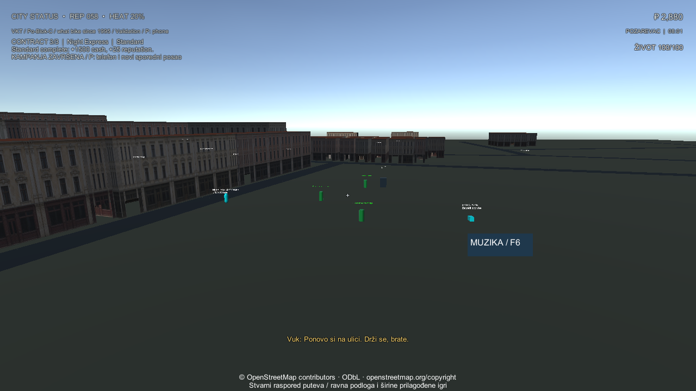

# VKT / Velika Krađa Točkova — Požarevac City

A modular Unity street-action prototype with missions, a cannabis-themed game economy, health, hazards and a configurable city clock. Source repository: [YashimiNatuki/VKT-PozarevacCity](https://github.com/YashimiNatuki/VKT-PozarevacCity). Growth and trading are abstract game mechanics; strain histories are attributed to breeder sources.

This repository is the standalone Unity source milestone. The older [browser/Three.js project](https://github.com/YashimiNatuki/3D-gta-Pozarevac) remains separate. No browser source or history is replaced.

## Current milestone — 2026-10-15

- Three sequential contracts with pickup, delivery and contact confirmation; Standard, Express and Ghost challenges.
- Four persistent garden pots; seed inventory, paid purchases, watering, growth, harvest and harvested-item inventory.
- First combat slice: E picks up stones/stick, Q cycles equipment, left mouse attacks. Punches, pooled swept stones, wall-blocked melee, nonlethal NPC reactions and one-time breakable-window heat are implemented. Touch has NAPAD/OPREMA controls. Equipment is session-only; it resets when the application restarts.
- Eight tradeable strains: Amnesia Haze, OG Kush, Wedding Cake, Purple Haze, AK-47, White Widow, Sour Diesel and Green Gelato. Five start unlocked; three unlock at reputation 30/60/100. Seed prices remain 60–420 game currency, with stable IDs preserving existing inventory saves.
- Three buyer profiles and three district price modifiers. Quotes vary by plant, buyer and district; sales consume inventory and pay once. These are counter orders selected through the market UI, not physical delivery routes to spawned customers.
- Health and damage logic, cooldown-protected hazards, session death/respawn and mission retry handling. This is a foundation for encounters, not finished animated dog/gang/armed-NPC AI.
- A configurable 18-minute day and 12-minute night; fog and sun follow the clock. The game clock is separate from real-time garden care.
- Touch movement/look/action controls alongside desktop input. Real-phone usability and performance remain unverified.
- Synthetic city ambience and dialogue playback slots. Three natural Serbian character voice recordings are still absent; subtitles do not constitute delivered voices.
- A local mini music player with F6/mobile controls, local MP3/OGG/WAV and three optional official SomaFM presets. Radio decoding is experimental and bounded to ten-minute sessions; continuous 24/7 playback is not verified. Sixteen local audio files were counted through metadata only; personal music is not published.
- Sixteen strain cards with attributed breeder histories; eight representative AI cannabis illustrations and stylized procedural plants. The phone shows the actual garden inventory; obsolete quick-economy buttons were removed. Illustrations are not authenticated cultivar photography.
- A bounded offline Požarevac center using 200 real OSM road segments and 40 building footprints, with original facade textures. Flat terrain, default widths and authored textures limit fidelity; this is not full-city photogrammetry.
- Repeatable three-chapter side jobs after the campaign, with completed counts/chapters persisted in save v4 alongside cash/reputation. Unfinished routes and their cooldown reset on reload without paying rewards.

**Current verification (2026-10-15, strain/combat wave):** 93 tests passed, zero failed and one optional ArcGIS test skipped (94 total). Windows build: zero errors, 227,743,368 bytes. Actual Windows and PC touch-preview player checks passed campaign, garden, save/restore, journal, side-job payout, physical equipment pickups, stone/window impact, melee NPC reaction, wall occlusion, cooldowns, projectile pool exhaustion/reuse, pause and death cleanup. A third garden run passed and its capture was inspected. Use `Launch-VKT.cmd` for the verified Direct3D11/four-worker startup path; an earlier default-worker startup stalled before scene load. Android ARM64/IL2CPP development APK: 52,119,391 bytes, minimum API 28/target 36, APK v2 signature verified. Package hashes are recorded in the street verification receipt. No phone was attached, so installation, touch usability and device performance remain unverified.

## Actual Windows player captures




## Map and art

The bundled map uses 200 OSM road segments and up to 40 real building footprints near 21.1854, 44.6199926, including Stari Korzo and Tabačka. **© OpenStreetMap contributors**, [ODbL 1.0](https://www.openstreetmap.org/copyright), applies to the derived JSON database. Heights use source tags/levels where available and explicitly marked defaults otherwise. Flat terrain, road widths, window placement and facade artwork are authored. This is a partial center, not a complete surveyed or photorealistic city.

The installed cannabis atlas and facade textures are original AI illustrations. The eight card images are representative artwork, not cultivar photographs or verified phenotype references. Procedural 3D plants, actors and interiors remain stylized prototype geometry. See [art provenance](Docs/Art-Provenance.md), [strain sources](Docs/Strain-Catalog-20261015.md), [map provenance](Docs/OpenStreetMap-Data.md) and [combat evidence](Docs/Street-Combat-20261015.md).

## Open and play

Use Unity **6000.6.5f1**. Open this folder, allow package restore, save any edited scene, then choose **VKT > Create portable offline playground**. Open the generated `Assets/Scenes/VKTOffline.unity` and press Play. The generator creates its own URP settings and offline scene. Public source excludes private streamed-map scenes, credentials, vendor media and personal music.

Desktop: WASD/mouse, Shift sprint, Space jump, E interact, P phone/catalog/jobs, N next contract, R retry, H hospital respawn, F6 music, Q equipment and left mouse attack. `-vktTouchPreview` enables the touch controls on desktop.

## Build standalone players

Windows batch entry point:

```powershell
& 'PATH/TO/Unity.exe' -batchmode -quit -projectPath $PWD -executeMethod Pozarevac.CityGame.Editor.CityPortableBuild.BuildWindows -vktOutput 'PATH/TO/Build/VKT.exe' -logFile 'PATH/TO/windows-build.log'
```

Distribute the whole Windows folder, including `VKT_Data` and supporting DLLs. Copy `Tools/Launch-VKT.cmd` next to `VKT.exe` and start that launcher for the verified Direct3D11/four-worker path; Unity Editor is not required. Development diagnostic backup folders are excluded from the distribution ZIP.

Android needs Unity Android Build Support, SDK/NDK/OpenJDK. `.BuildAndroid` builds an APK with ARM64, IL2CPP, API 28 minimum and landscape orientation, then restores prior settings. For Windows installations requiring the existing OS trusted-root store, the split export/assemble script uses PowerShell 7:

```powershell
pwsh -File Tools/Build-Android.ps1 -UnityPath 'PATH/TO/Unity.exe' -OutputDirectory 'PATH/TO/AndroidBuild' -UseWindowsRootTrust
```

It exports through `.ExportAndroidProject` then invokes bundled Gradle with explicit launcher and daemon JVM flags. TLS verification remains enabled; no certificates are imported. See [build notes](Docs/Build-Notes-20261015.md). These are development builds, not signed store releases. iOS needs a separate Mac/Xcode/signing pipeline and is not delivered.

## Source layout

| Path | Purpose |
| --- | --- |
| `Assets/CityGame/Runtime` | Gameplay, UI, economy, save, map, music and input |
| `Assets/CityGame/Tests/Editor` | Deterministic/integration/geometry tests |
| `Assets/CityGame/Editor/CityPortableBuild.cs` | Reproducible offline scene and build entry points |
| `Tools/Build-Android.ps1` | Split Android export and Gradle assembly |
| `Tools/Audio/generate_voices.py` | Local Piper voice baking; no models or automatic downloads |
| `Tools/Export-Source.ps1` | Allowlisted export, dry run by default |
| `Docs` | Evidence, provenance, limitations and next work |

## Next work

1. Install/test the verified Android development APK on a real ARM64 phone: touch, save/resume, economy, damage, frame time, memory and thermals.
2. Add furnished interiors, sidewalks/junctions and recognizable authored landmarks; perimeter walls now block movement with authored visible door passages, while roofs have no walking collision.
3. Add physical customer delivery routes, animated encounters and durable equipment/unlock saves. Slingshot, water pistol, fictional firecracker and tank remain planned content; none is playable yet.
4. Obtain three natural Serbian character voices with clear rights and authentic city ambience. Validate long-running radio; endpoint discovery does not prove 24/7 playback.
5. Expand route stations and branching stories; completed job/chapter progress now persists, while unfinished jobs are safely abandoned on reload.

See [milestone](Docs/Milestone-20261014.md), [platform/audio readiness](Docs/Platform-Audio-Plan-20261014.md), [music](Docs/Music.md), [source boundaries](Docs/Source-Publication.md) and [third-party notices](THIRD_PARTY_NOTICES.md). MIT covers first-party code under [LICENSE](LICENSE); OSM, Unity and dependencies retain their own terms.

Latest wave: [street-action and strain catalog](Docs/Street-Combat-20261015.md), [current verification receipt](Docs/Verification-Street-20261015.json). Earlier gameplay status: [2026-10-15 gameplay upgrade](Docs/Gameplay-20261015.md), [verification receipt](Docs/Verification-Gameplay-20261015.json). Earlier city/art/audio package hashes: [baseline receipt](Docs/Verification-20261015.json). Binary packages were produced locally; this repository publishes source and captures, not a binary release.
