> **Najnovije Windows izdanje: statistika igrača / profil v9 — 2026-10-21.** [Preuzmi Windows ZIP](https://github.com/YashimiNatuki/VKT-PozarevacCity/releases/download/vkt-player-stats-20261021/VKT-Stats-Windows-20261021.zip). **P → MOJA STATISTIKA** prikazuje stvarni hod, trčanje, aktivno vreme i preživljavanje; podaci se čuvaju i nastavljaju posle učitavanja. Pauza/telefon ne dodaju vreme; teleport ne dodaje metre. **222 uspešna testa, 0 neuspešnih, 1 preskočen; završni prolazi kroz Windows igru sa tastaturom i rasporedom za dodir su prošli.** [Tok, provere i granice](Docs/Player-Stats-20261021.md) | [Dokazi](Docs/Verification-Player-Stats-20261021.json) | [Aktuelni handoff](HANDOFF-NASTAVAK.md). Stariji profili do v8 dobijaju praznu statistiku; starija izdanja ne čitaju v9. Skejt/novi pešaci iz paralelnog predloga ostaju kandidati. Nema novog APK/IPA niti fizičkog mobilnog testa.

> **Previous Windows preview: garden orders / profile v8 — 2026-10-20.** [Windows ZIP](https://github.com/YashimiNatuki/VKT-PozarevacCity/releases/download/vkt-garden-orders-20261020/VKT-Garden-Orders-Windows-20261020.zip). After three campaign contracts, the hideout order desk packs two real catalog-stock units, sends the player to the existing marker-2 contact and requires a receipt returned to the hideout for a single payout. Cargo, receipt, agreed price and remaining time survive save/load. Cancellation/death/timeout lose cargo without refund or payout; pursuit/training/parallel deliveries are gated. **209 Unity tests passed, zero failed, one skip; final desktop/touch-preview flows and broader Windows regression passed.** [Flow and architecture](Docs/Garden-Orders-20261020.md) | [Evidence](Docs/Verification-Garden-Orders-20261020.json) | [Next steps](Docs/Rodja-Roadmap-20261020.md). Profiles v1-v7 migrate to v8; older builds cannot read v8. No new Android/iOS package, character mesh, natural voice, terrain or intro video is claimed.

> **Previous Windows preview: street signals + hideout score — 2026-10-20.** [Windows ZIP](https://github.com/YashimiNatuki/VKT-PozarevacCity/releases/download/vkt-street-sound-20261020/VKT-Street-Sound-Windows-20261020.zip). **G / ZVIŽDI** attracts nearby existing patrols/local hazards through a clear path, with cooldown and no automatic crime. Original hideout instrumental respects personal music and mute. **201 Unity tests passed; final native desktop/touch-preview flows and broader Windows regression passed.** [Changes and limits](Docs/Street-Sound-20261020.md) | [Ordered Rođa roadmap](Docs/Rodja-Roadmap-20261020.md) | [Evidence](Docs/Verification-Street-Sound-20261020.json). Windows only in this release; Android v8 below is the earlier build. No new realistic face, elevation, natural voice bank or intro video is claimed.

> **Previous: gameplay recovery / Android v8 - 2026-10-20.** [Windows ZIP](https://github.com/YashimiNatuki/VKT-PozarevacCity/releases/download/vkt-controls-recovery-20261020/VKT-Controls-Windows-20261020.zip) | [Android APK](https://github.com/YashimiNatuki/VKT-PozarevacCity/releases/download/vkt-controls-recovery-20261020/VKT-Controls-Android-20261020.apk). Four onboarding/help pages, visible phone/map/character buttons, Noto Sans UI, compact music without pausing gameplay, touch-preview movement recovery, articulated knees and explicit training prerequisites. **197 Unity tests passed; final desktop/touch-preview input flows and broader Windows smoke passed.** Android update preserves profile v7; user confirmed touch navigation on the first v8 candidate. [Changes and limits](Docs/Gameplay-Recovery-20261020.md) | [Serbian TXT controls/plan](Docs/VKT-KONTROLE-I-PLAN-20261020.txt) | [Verification](Docs/Verification-Gameplay-Recovery-20261020.json). The head remains stylized, natural NPC speech and terrain elevation remain future work.

> **Konglomerat / Rodja local tools 0.2.1:** [portable kit](https://github.com/YashimiNatuki/VKT-PozarevacCity/releases/download/vkt-controls-recovery-20261020/Konglomerat-Rodja-Local-Kit-0.2.1.zip) | [installation and scope](Tools/VktStudio/marketplace/README.md). Three optional local skills; not required to play.

> **Previous tooling milestone: VKT Thug Life Studio 0.1.2** adds three local Codex skills and read-only verification helpers. The vulnerable optional Coqui/VITS generator/install path is retired with existing models/WAVs preserved; no new game binary or natural voice is claimed. [Separate feature/tooling handoff](Docs/VKT-STUDIO-I-DODATNI-ZAHTEVI-20261018.txt). Windows remains the main development target.

> **Previous binary milestone: Expression + Audio v7**: [Android APK](https://github.com/YashimiNatuki/VKT-PozarevacCity/releases/download/vkt-expression-audio-20261018/VKT-Expression-Android-20261018.apk) | [Windows ZIP](https://github.com/YashimiNatuki/VKT-PozarevacCity/releases/download/vkt-expression-audio-20261018/VKT-Expression-Windows-20261018.zip). Gameplay facial states, wardrobe expression selector and explicit voice/audio diagnostics. **186 tests passed**, Windows runtime checks passed, Android update installed and launched; new v7 hardware checks remain pending after USB disconnection. [Changes and limits](Docs/Expression-Audio-20261018.md) | [Complete Serbian TXT guide](Docs/VKT-A-DO-SH-20261018.txt). The low-poly head remains; NPC voice recordings are still absent.

> Android **v6** is installed and tested on the connected phone: [download APK](https://github.com/YashimiNatuki/VKT-PozarevacCity/releases/download/vkt-character-android-20261018/VKT-Character-Android-20261018.apk). City startup, wardrobe/portrait, camera/movement, music UI and background/resume exercised; intro audio heard by the user. Fixed stripped collider types and music/jump overlap. [Evidence, FPS sample and remaining limits](Docs/Character-Android-20261018.md). NPC dialogue still uses captions; spoken recordings are not bundled.

> Previous character/HUD Windows preview: [download ZIP](https://github.com/YashimiNatuki/VKT-PozarevacCity/releases/download/vkt-character-ui-20261018/VKT-Character-Windows-20261018.zip). Smaller head/neck/extremities, fitted cap, atlas blink/effort, wardrobe portrait view and less obstructive training HUD. [Changes, verification and next priorities](Docs/Character-UI-20261018.md). The existing face remains stylized; no facial rig or lip sync yet. The Android v6 build above includes these character features plus the hardware-tested Android fixes.

# VKT / Velika Krađa Točkova — Požarevac City

## Previous: mission resume, boxing and Android - 2026-10-18

Profile **v7** resumes active campaign and street routes with their challenge, cargo/receipt phase, remaining game time and deterministic offer. Balances and settled mission state share one atomic save, so loading does not replay a payout. Existing v1-v6 gardens, clothing and progression migrate. Checkpoints save at handovers, not only after a balance change.

At the gym choose **L / BOKS**: eight timed jab/guard reactions using J/K or touch buttons, at least six correct to earn 30 XP once. Boxing develops endurance independently of bench strength. A standing guard/jab pose, bag and dedicated collision-aware camera work from first person too. Shared training rest persists; incomplete workouts do not resume or pay after loading.

Patrols investigate reported incidents and the last visible position, search locally and reacquire by line of sight. They do not continuously know a hidden player's location. Pavement/grass footsteps and dialogue ducking extend the existing audio. Sixteen nearby footprints gain original curved cornices/door trim. The real Copernicus raster was sampled at eight candidate locations, with provenance and datum recorded; **street terrain remains flat pending review/correction**. A free local Serbian voice candidate was synthesized outside the game and rejected by the user as understandable but robotic; a second VITS candidate runs locally but awaits listening review. A natural multi-actor bank remains open work.

[Windows ZIP](https://github.com/YashimiNatuki/VKT-PozarevacCity/releases/download/vkt-resume-20261018/VKT-Resume-Windows-20261018.zip) | [Android APK](https://github.com/YashimiNatuki/VKT-PozarevacCity/releases/download/vkt-resume-20261018/VKT-Resume-Android-20261018.apk) | [Design, limits and next priorities](Docs/Resume-Boxing-Android-20261018.md) | [Verification](Docs/Verification-Resume-20261018.json)

The original intro is included in both builds. Extract the complete Windows ZIP and run Launch-VKT.cmd; Android uses ARM64, Android 9+, landscape, development signing and version code 3. Physical touch/audio/thermal-FPS checks remain pending until a device is connected. Android development players write local frame/touch/audio configuration diagnostics; these are not a substitute for listening and control checks. Review the machine-readable receipt for actual final tests, build outcomes and SHA256 hashes.

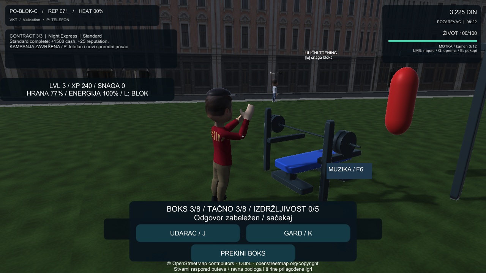


A modular Unity street-action prototype with missions, a cannabis-themed game economy, health, hazards and a configurable city clock. Source repository: [YashimiNatuki/VKT-PozarevacCity](https://github.com/YashimiNatuki/VKT-PozarevacCity). Growth and trading are abstract game mechanics; strain histories are attributed to breeder sources.

This repository is the standalone Unity source milestone. The older [browser/Three.js project](https://github.com/YashimiNatuki/3D-gta-Pozarevac) remains separate. No browser source or history is replaced.

## Development tools installed - 2026-10-17

Game Development Studio 1.5.1, a dedicated Node 24 LTS, Blender 4.5.9 LTS, FFmpeg/FFprobe 9.0.2 and an isolated Hugging Face/GIS/mesh Python environment are installed on the development PC. Five local Game Development Studio skills and user-shell launchers are configured. Native model import/export, asset inspection, audio metadata, synthetic capture comparison and GIS/GLB checks passed. These are development capabilities; the playable Windows release below is unchanged.

[Setup, versions and next use](Docs/Toolchain-20261017.md) | [Verification receipt](Docs/Verification-Toolchain-20261017.json). Check the installed environment with `vkt-python.cmd Tools/Toolchain/verify.py`.

## Previous: connected mission routine, conditioning and audio - 2026-10-17

Mission contacts now honor actual wanted/training state, including wanted at zero HEAT. Jobs expose pickup/cargo/delivery-receipt phases and pay once at final confirmation. The director freezes timers on application suspension; pursuit alone does not freeze a delivery deadline. The journal now scrolls on touch or mouse wheel.

At the physical gym, **KONDICIJA / 3 stanice** adds a 75-second walking/sprinting course: hold three blue checkpoints for 1.2 seconds each, earn 20 XP once, and share durable rest with bench training. No bench-strength award is invented. New original checkpoint/success/failure cues honor mute, pause and application suspension; suspended movement cannot start footsteps.

**Verified:** 159 Unity tests passed, zero failed, one optional skip; 16 backend tests passed. Windows build has zero errors. Actual Windows player checks passed wanted contact blocking, staged settlement, pause/suspension timing, journal scrolling, conditioning touch-start/dwell/XP/save/cancellation and feedback audio. Prior intro, spatial occlusion, character, gym, mission, garden, combat and save checks also passed. Screenshots were reviewed and a clipped conditioning panel was repaired and retested.

[Download Windows development ZIP](https://github.com/YashimiNatuki/VKT-PozarevacCity/releases/download/vkt-routine-20261017/VKT-Routine-Windows-20261017.zip) | [Design, before/after and prioritized next improvements](Docs/Routine-Missions-Audio-20261017.md) | [Verification receipt](Docs/Verification-Routine-20261017.json)

Profile v6 is retained. Conditioning progress is transient; XP/rest persist. Existing active-job reload behavior is unchanged. No new Android APK/device test, terrain, districts or natural voice bank is claimed.

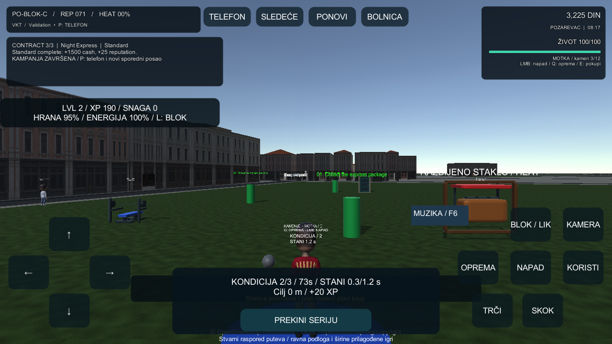

## Previous: local AI availability and recovery - 2026-10-17

Contacts now verify the local companion before sending game facts and explain missing service, missing model, warmup, busy generation, rate limiting, cooldown and timeout in Serbian. Cached conversations remain usable when their model is unavailable. Authored dialogue and authoritative local objectives remain available without any AI service. `Tools/LocalAI/doctor.py` performs read-only diagnostics using standard Python.

**Verified:** 148 Unity tests passed, zero failed, one optional skip; 16 backend tests passed. Windows build completed with zero errors. Actual Windows player runs passed with required live AI/cache and, separately, with the companion stopped and an explicit recovery message. The first strict live attempt fell back to authored text; local generation is not guaranteed on every attempt. Existing intro, city/collision, audio, character, gym, mission, garden and save checks also ran.

[Download Windows development ZIP](https://github.com/YashimiNatuki/VKT-PozarevacCity/releases/download/vkt-ai-status-20261017/VKT-AI-Status-Windows-20261017.zip) | [Setup, boundaries and bench roadmap](Docs/AI-Reliability-20261017.md) | [Verification receipt](Docs/Verification-AI-Status-20261017.json)

No new login or API key is needed for the local Ollama path. Remote Android AI, BYOK and the animated talking bench are future work. This release adds no terrain/elevation or Android APK.

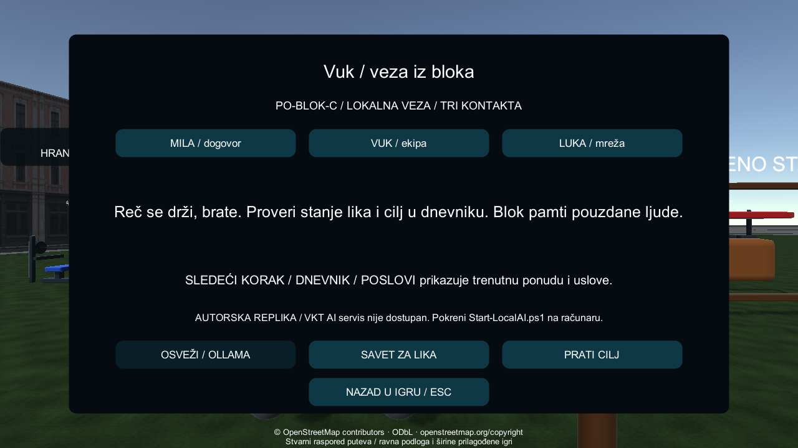

## Previous: connected streets and map visibility - 2026-10-17

The existing OSM map now composes shared road/sidewalk edges through a bounded endpoint graph, authored asphalt junction surfaces and sidewalk pullbacks. Compact double-sided street placards replace oversized floating names. Building/sign renderers use distance hysteresis while all existing wall/ground colliders and mission simulation stay active.

**Verified:** 146 Unity tests passed, zero failed, one optional skip. Windows build completed with zero errors. Actual player checks passed map composition, hiding/restoring the map with 879 active colliders retained, and prior intro/audio/character/mission/garden/combat/save regression. The original intro remains included unchanged.

[Download Windows development ZIP](https://github.com/YashimiNatuki/VKT-PozarevacCity/releases/download/vkt-streets-20261017/VKT-Streets-Windows-20261017.zip) | [Map/terrain research and implementation](Docs/Map-Streets-20261017.md) | [Verification receipt](Docs/Verification-Streets-20261017.json)

Terrain remains flat and coverage is unchanged. This release does not claim imported DEM/satellite terrain, realistic elevation, new neighborhoods, traffic simulation, measured FPS gains or a new Android APK. The next terrain step needs a reviewed height raster and road/building/mission height integration.

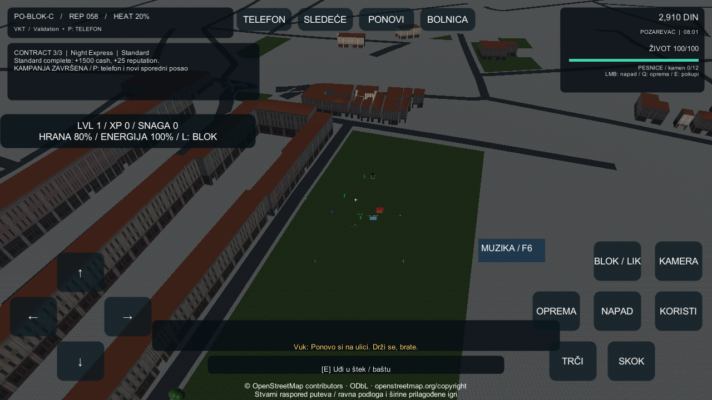

## Previous: original intro, spatial audio and hideout - 2026-10-17

The original 43.5-second project intro is back in the Windows ZIP; previous portable builds excluded its video. **PRESKOČI UVOD**, Space or Esc skips it. Missing media now has an explicit short title card. Six mono positional ambience sources, wall low-pass/attenuation, a world-space patrol siren, indoor fan/reverb and movement sound fallbacks improve the audio composition. These effects are synthetic; no authentic city recordings or binaural HRTF is claimed.

The existing character gains additive breathing, torso/turn motion, head glance and a wardrobe-colored wristwatch. The hideout gains rounded pots, furniture, a fan and **E / PLAN BLOKA** desk opening the existing journal. Two new job types add heat-limited contact acceptance and handover while the deadline continues.

**Verified:** 142 Unity tests passed, zero failed, one optional skip. Windows build completed with zero errors. Actual player regression passed original video decoding/touch skip, six spatial sources, one listener, wall insertion/removal, mute/suspend, indoor source selection, journal pause, breathing and prior gameplay. Separate player runs passed natural movie completion and missing-media fallback. The packaged movie hash matches the original.

[Download Windows development ZIP](https://github.com/YashimiNatuki/VKT-PozarevacCity/releases/download/vkt-atmosphere-20261017/VKT-Atmosphere-Windows-20261017.zip) | [Changes, free library research and limitations](Docs/Atmosphere-Intro-20261017.md) | [Verification receipt](Docs/Verification-Atmosphere-20261017.json)

Headphone listening, natural Serbian voice casting, recorded ambience and Steam Audio integration remain future validation/work. No new Android APK in this wave.

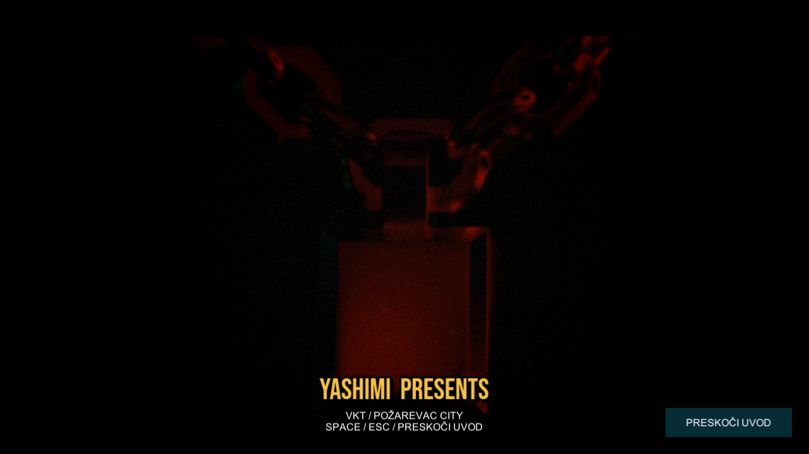

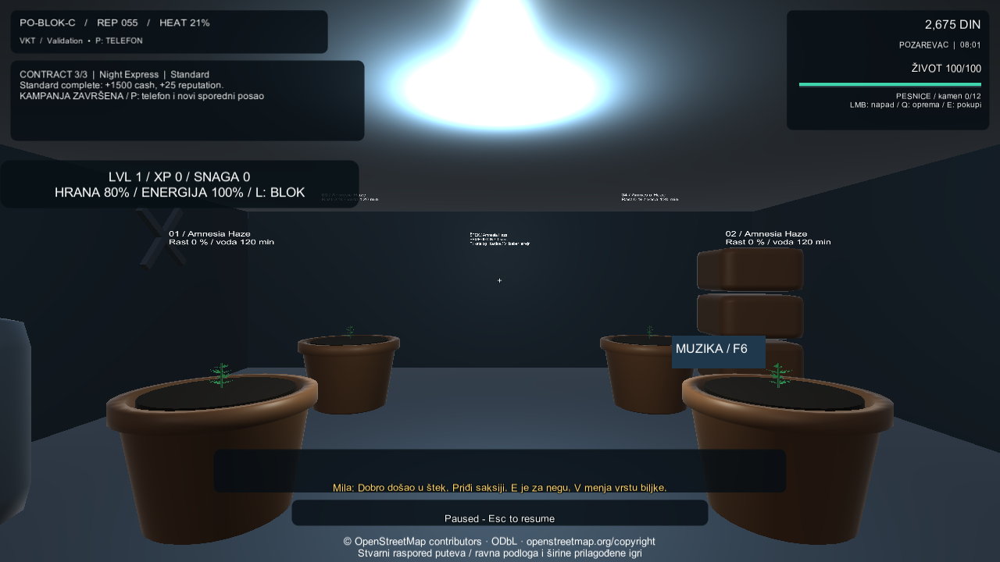

## Previous: local Ollama contacts and state-aware objectives - 2026-10-17

**L / BLOK / LIK > KONTAKTI / OLLAMA** opens Mila, Vuk and Luka. Authored offline text works immediately. Optional local Ollama generates a short sentence; the UI labels generated, cached and authored responses separately. Unity chooses the next objective from pursuit, food, stamina, campaign and current jobs. AI cannot change rewards, cash or progress.

The free local companion uses FastAPI/Pydantic, a bounded SQLite WAL cache, one generation worker, request limits, timeouts and a failure circuit. No paid API, model download, credentials or save transfer is required. The ZIP includes the optional backend source/start script; Python and an installed local Ollama model are separate prerequisites.

**Verified:** 141 Unity tests passed, zero failed, one optional ArcGIS skip; 12 backend tests passed. Windows build completed with zero errors. Two actual Windows player runs passed live Ollama and server-offline fallback, UI pause/cancellation/close, unchanged economy/mission state and previous gameplay regression.

[Download Windows development ZIP](https://github.com/YashimiNatuki/VKT-PozarevacCity/releases/download/vkt-localai-20261017/VKT-LocalAI-Windows-20261017.zip) | [Setup, architecture and limitations](Docs/Local-AI-20261017.md) | [Verification receipt](Docs/Verification-LocalAI-20261017.json)

This is an optional text narrative layer. Small-model Serbian still needs editorial work; cold generation may take tens of seconds. No new Android APK, natural voices or multiplayer service is delivered in this wave.

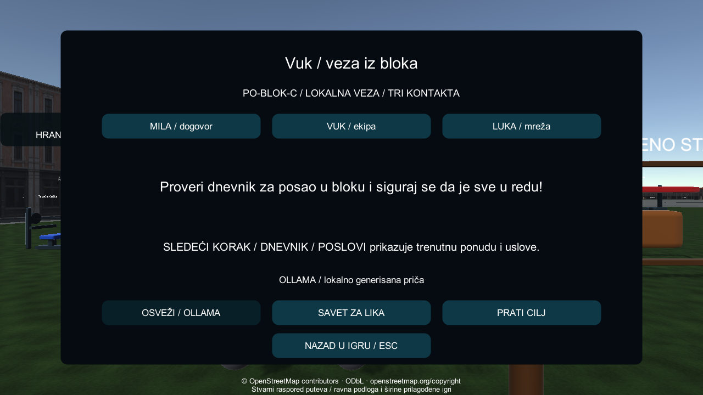

## Previous: character body, clothes and wardrobe - 2026-10-16

Adult body proportions, smaller head/hands, stable 1.8 m base height, strength-dependent chest/arm/leg shaping and a curved cap update the existing player. Three free outfits use a custom URP clothing shader. **L / BLOK / LIK > ODEĆA / 3D GARDEROBER** opens the paused full-body turntable. Outfits persist in profile v6; v1–v5 profiles migrate. The world player and bench use the same look. Walk/run clip timing and arm swing follow measured movement speed.

**Verified:** 134 EditMode tests passed, zero failed, one optional ArcGIS skip. Windows build completed with zero errors; actual Windows player checks passed all wardrobe buttons, preview selection, pause ownership, v6 outfit save/load, matching world/bench clothes and prior gameplay/bench regression.

[Download Windows development ZIP](https://github.com/YashimiNatuki/VKT-PozarevacCity/releases/download/vkt-character-20261016/VKT-Character-Windows-20261016.zip) | [Controls and limitations](Docs/Character-Upgrade-20261016.md) | [Verification receipt](Docs/Verification-Character-20261016.json)

This remains a revised stylized character, not a photorealistic human. New garment silhouettes, facial/finger rigging and a full locomotion blend tree remain future work. No new Android APK in this wave.

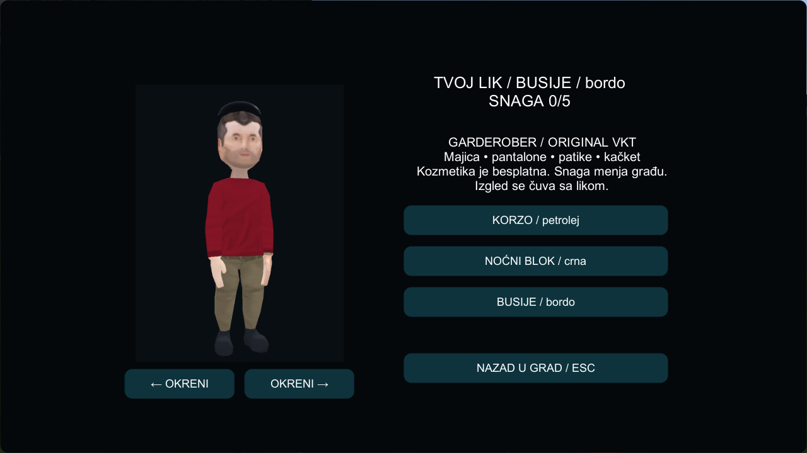


## Previous: bench press and character posing - 2026-10-16

The street gym now has a real-time bench press sequence: eight complete lower/press repetitions within 45 seconds, a timed press window, round plate weights, planted feet, articulated arms and a side camera. The same player skin/skeleton is reused. Early taps and incomplete strokes earn no repetitions; walking, jumping and attacks are blocked during the set. Saved strength subtly changes chest/shoulder proportions.

**Verified:** 125 EditMode tests passed, zero failed, one optional skip; Windows build completed with zero errors. See [controls, scope and limitations](Docs/Bench-Training-20261016.md). Existing profile v5, food, police and mission progression remain integrated. Android binaries from earlier milestones do not include this update.

[Download new Windows ZIP](https://github.com/YashimiNatuki/VKT-PozarevacCity/releases/download/vkt-bench-20261016/VKT-Bench-Windows-20261016.zip) | [Verification receipt](Docs/Verification-Bench-20261016.json)

Actual Windows player regression passed gym repetitions, attack gating, hand/foot contacts, meals, pursuit, profile v5, missions, garden, combat and the existing three cameras.

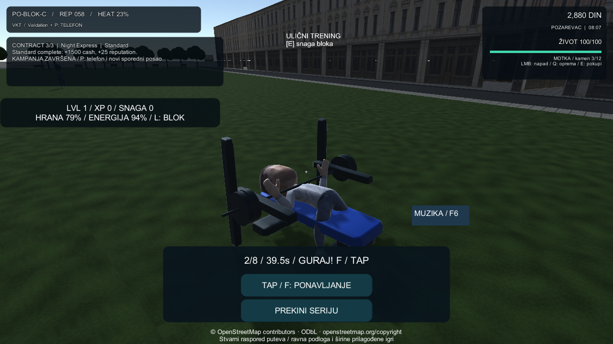

## Previous: Block Life development milestone - 2026-10-16

**L / BLOK / LIK** opens character development. A physical street gym offers a 24-tap / 15-second workout; food, stamina, XP and strength affect the character. Buy a 35 DIN meal or steal it and trigger a foot pursuit. Two patrols use physics visibility and local steering, with escape, arrest, fines, a paused/muted procedural siren and one-time neighborhood challenge rewards.

**Verified:** 121 tests passed, 0 failed, 1 optional skip. Final Windows build: 0 errors; two actual Windows player runs passed existing gameplay and the new gym/food/police/save checks. Profile v5 accepts v1-v4 saves. Android hardware runtime/performance is still unverified.

[Android APK and Windows development release](https://github.com/YashimiNatuki/VKT-PozarevacCity/releases/tag/vkt-blocklife-20261016) | [Controls, rules and limitations](Docs/Block-Life-20261016.md) | [Verification receipt](Docs/Verification-BlockLife-20261016.json)

The catalog has **16 identity cards / 8 tradeable strains**. **18 candidate city locations** are accessible in the new panel; street-job contacts use neighborhood names. Physical neighborhood coverage remains the bounded central map. This remains a stylized prototype with unfinished navigation, traffic/driving and natural spoken dialogue.

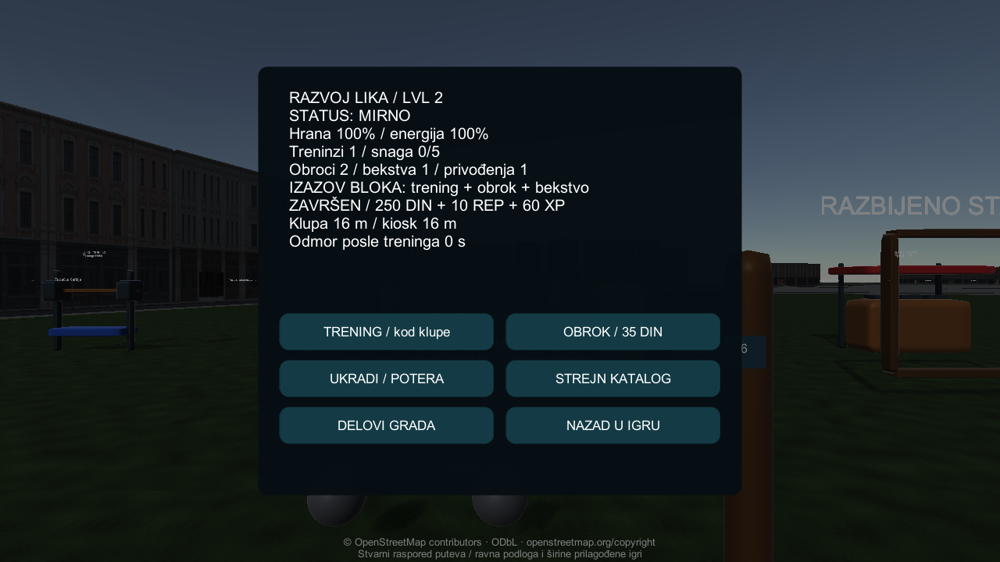

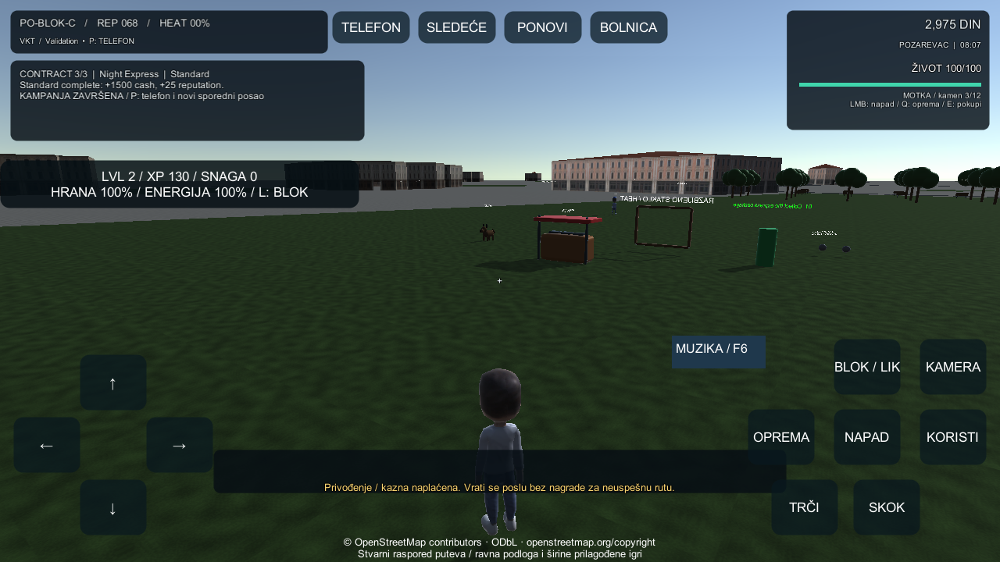

## Previous: three perspectives and Android access — 2026-10-16

**C** on desktop / **KAMERA** on touch cycles first person, shoulder and chase. Third person shows the animated player character. Camera obstruction checks retract before walls; interactions and attacks keep eye-origin reach. V remains strain selection. Character height remains 1.8 m and the map stays in meters; city coverage is unchanged.

The hideout entrance now has rounded door/frame/panel/handle/canopy detail. Tree crowns have a less uniform silhouette. Touch controls respect the reported screen safe area. See [implementation and device limitations](Docs/Camera-Perspectives-20261016.md) and [verification receipt](Docs/Verification-Perspectives-20261016.json).

Android: download the APK from the [perspectives development release](https://github.com/YashimiNatuki/VKT-PozarevacCity/releases/tag/vkt-perspectives-20261016), open it and allow installation from your browser if prompted. Requires ARM64 Android 9+. The older [visual-only APK](https://github.com/YashimiNatuki/VKT-PozarevacCity/releases/download/vkt-visual-20261016/VKT.apk) remains available separately.
**Current verification:** 107 passed, 0 failed, 1 optional ArcGIS skip (108 total). Final Windows build: 0 errors, 228,302,104 build-report bytes. All three final perspective runs passed campaign, physical garden, persistent saves, audio, combat and camera obstruction/restoration checks. All three captures were inspected. Physical Android runtime/performance remains unverified.

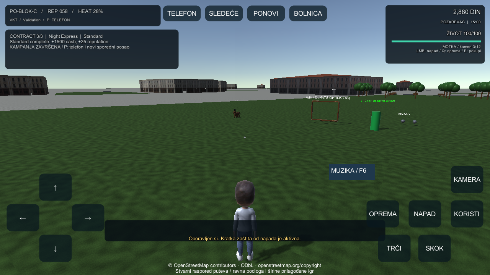

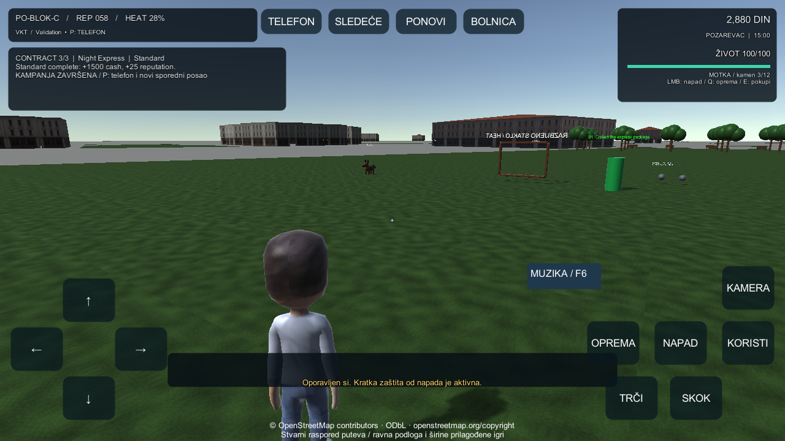
## Visual upgrade — 2026-10-16

Rounded ceramic planters, curved props and a round held stick replace selected box placeholders. Textured Kenney CC0 humans have correctly scaled idle/run animation and relaxed arms. Pitched roofs, repeating asphalt/paving/grass textures, a procedural sky, soft shadows and modest URP grading improve the center. Rounded HUD/phone cards, health bar and separated touch controls improve readability.

**Verified:** 105 tests passed, zero failed, one optional ArcGIS skip. Windows build: zero errors, 228,300,069 build-report bytes. Three actual Windows player runs passed gameplay/save/audio/visual checks; all captures were inspected. Android ARM64 IL2CPP development APK: 52,387,351 bytes, API 28–36, v2 signature verified. Physical-phone runtime/performance remain unverified. This is still a stylized prototype with flat terrain and incomplete landmark detail.

See [visual implementation](Docs/Visual-Upgrade-20261016.md), [current receipt](Docs/Verification-Visual-20261016.json) and [art provenance](Docs/Art-Provenance.md). Next priorities: authored central landmarks, measured device performance, traffic/driving and recorded Serbian dialogue.

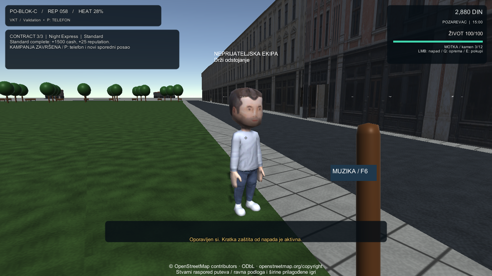

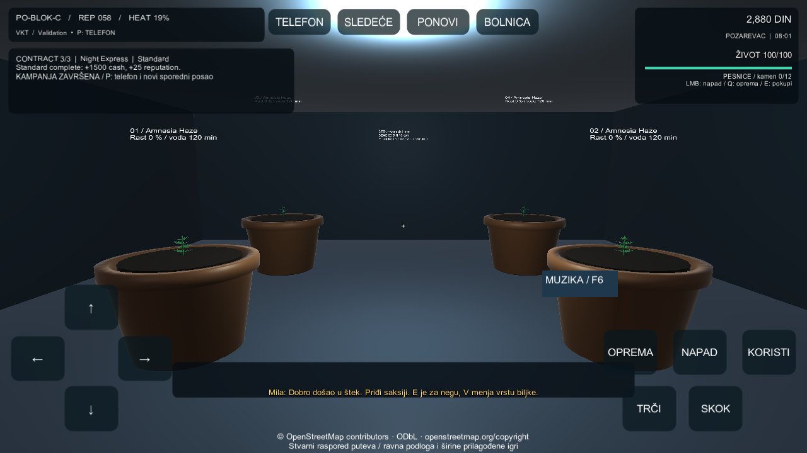

## Previous geography/audio milestone — 2026-10-16

- Expanded offline center: **600 OSM road segments, 100 footprints and 22 green outlines**, within ±650 m. Added authored visual sidewalks, 12 benches and 24 trees with road/building exclusion checks.
- New **P → MAPA** phone view: north-up streets/buildings/green outlines, player marker, scale and attribution. One bounded texture is generated once; marker updates at 5 Hz.
- Fixed ground selection so a street-level arrival prefers nearby authored ground instead of the highest overhead roof.
- Audio now handles gameplay pause, independent music/master mute, dialogue ducking, cleanup and deferred playback after application suspension. PC runtime confirms loading silently during a simulated pause callback and starting on resume.
- Added 18 user-supplied candidate place pins with stable IDs and bounded meter projection. Pins are not surveyed district boundaries; the conflicting Ljubičevo/Hipodrom pin is flagged. Existing save/map origin stays unchanged.
- Side-job chapter briefings now follow a fictional local programmer-courier building a reliable neighborhood network. No personal likeness or biography is claimed.

## Gameplay systems retained

- Three sequential contracts with pickup, delivery and contact confirmation; Standard, Express and Ghost challenges.
- Four persistent garden pots; seed inventory, paid purchases, watering, growth, harvest and harvested-item inventory.
- First combat slice: E picks up stones/stick, Q cycles equipment, left mouse attacks. Punches, pooled swept stones, wall-blocked melee, nonlethal NPC reactions and one-time breakable-window heat are implemented. Touch has NAPAD/OPREMA controls. Equipment is session-only; it resets when the application restarts.
- Eight tradeable strains: Amnesia Haze, OG Kush, Wedding Cake, Purple Haze, AK-47, White Widow, Sour Diesel and Green Gelato. Five start unlocked; three unlock at reputation 30/60/100. Seed prices remain 60–420 game currency, with stable IDs preserving existing inventory saves.
- Three buyer profiles and three district price modifiers. Quotes vary by plant, buyer and district; sales consume inventory and pay once. These are counter orders selected through the market UI, not physical delivery routes to spawned customers.
- Health and damage logic, cooldown-protected hazards, session death/respawn and mission retry handling. This is a foundation for encounters, not finished animated dog/gang/armed-NPC AI.
- A configurable 18-minute day and 12-minute night; fog and sun follow the clock. The game clock is separate from real-time garden care.
- Touch movement/look/action controls alongside desktop input. Real-phone usability and performance remain unverified.
- Synthetic city ambience and dialogue playback slots. Three natural Serbian character voice recordings are still absent; subtitles do not constitute delivered voices.
- A local mini music player with F6/mobile controls, local MP3/OGG/WAV and three optional official SomaFM presets. Radio decoding is experimental and bounded to ten-minute sessions; continuous 24/7 playback is not verified. Sixteen local audio files were counted through metadata only; personal music is not published.
- Sixteen strain cards with attributed breeder histories; eight representative AI cannabis illustrations and stylized procedural plants. The phone shows the actual garden inventory; obsolete quick-economy buttons were removed. Illustrations are not authenticated cultivar photography.
- A bounded offline Požarevac center using 600 selected OSM road segments, 100 building footprints and 22 green polygons, with original facade textures. Flat terrain, default widths and authored textures limit fidelity; this is not full-city photogrammetry.
- Repeatable three-chapter side jobs after the campaign, with completed counts/chapters introduced in save v4 and retained in v5 alongside cash/reputation. Unfinished routes and their cooldown reset on reload without paying rewards.

**Previous geography/audio verification (before the visual upgrade):** 100 tests passed, zero failed and one optional ArcGIS test skipped (101 total). Final Windows build: zero errors, 227,927,900 bytes. Actual PC and PC touch-preview runs passed campaign, garden, saved progress, map/pause ownership, city geometry, physical combat and suspended audio loading/resume. Scene composition: 878 wall colliders, 12 benches, 24 trees. Captures were inspected. Android ARM64/IL2CPP development APK: 52,149,495 bytes, minimum API 28/target 36, APK v2 signature verified. Package hashes are recorded in the current receipt; no physical-phone runtime/performance or subjective voice listening is claimed. Use `Launch-VKT.cmd` for the verified startup path.

## Actual Windows player captures

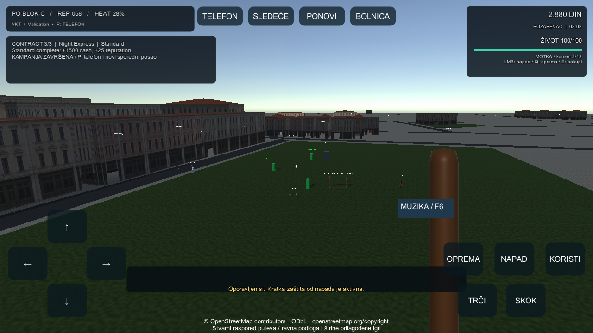

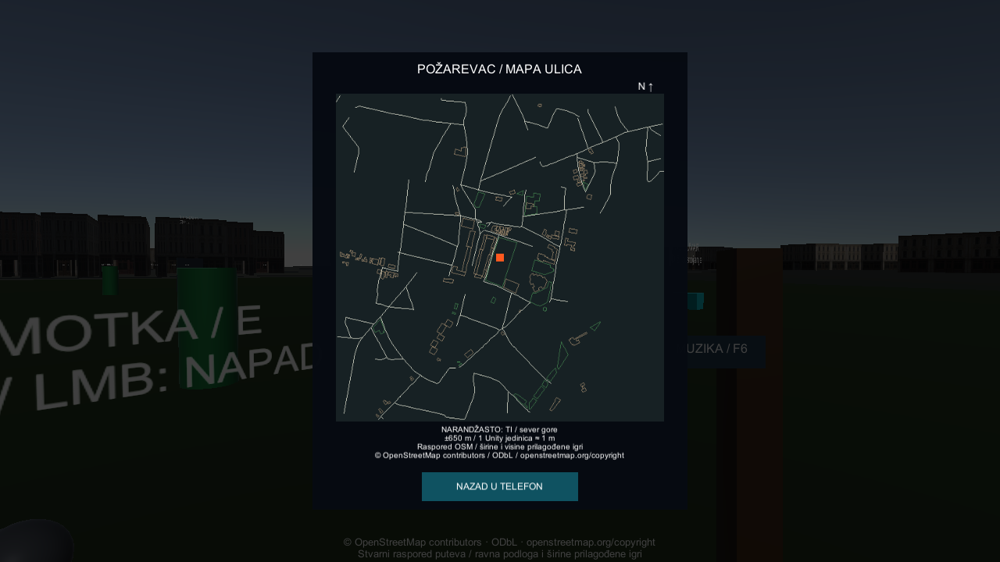

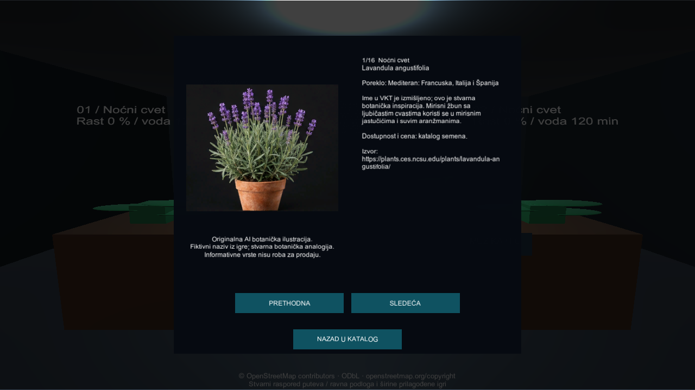

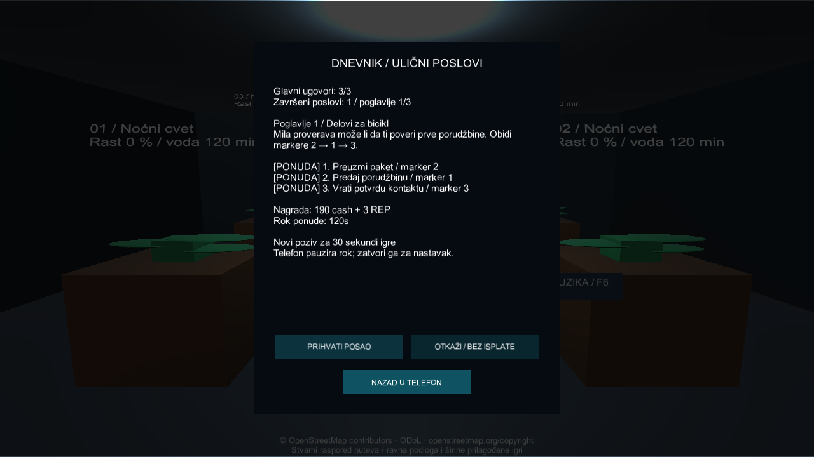

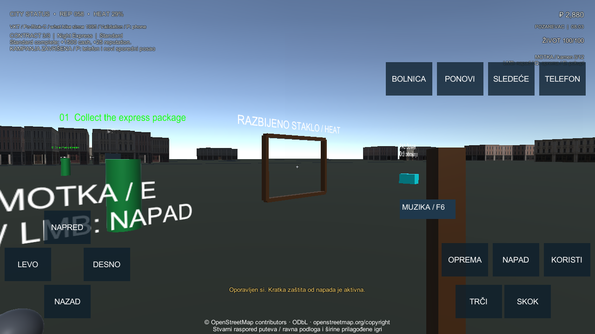

## Map and art

The bundled map uses 600 selected OSM road segments, 100 real building footprints and 22 green polygons near 21.1854, 44.6199926, including Stari Korzo and Tabačka. **© OpenStreetMap contributors**, [ODbL 1.0](https://www.openstreetmap.org/copyright), applies to the derived JSON database. Heights use source tags/levels where available and explicitly marked defaults otherwise. Flat terrain, road widths, window placement and facade artwork are authored. This is a partial center, not a complete surveyed or photorealistic city.

The installed cannabis atlas and facade textures are original AI illustrations. The eight card images are representative artwork, not cultivar photographs or verified phenotype references. Procedural 3D plants, actors and interiors remain stylized prototype geometry. See [art provenance](Docs/Art-Provenance.md), [strain sources](Docs/Strain-Catalog-20261015.md), [map provenance](Docs/OpenStreetMap-Data.md) and [combat evidence](Docs/Street-Combat-20261015.md).

## Open and play

Use Unity **6000.6.5f1**. Open this folder, allow package restore, save any edited scene, then choose **VKT > Create portable offline playground**. Open the generated `Assets/Scenes/VKTOffline.unity` and press Play. The generator creates its own URP settings and offline scene. Public source excludes private streamed-map scenes, credentials, vendor media and personal music.

Desktop: WASD/mouse, Shift sprint, Space jump, E interact, P phone/catalog/map/jobs, N next contract, R retry, H hospital respawn, F6 music, Q equipment and left mouse attack. `-vktTouchPreview` enables the touch controls on desktop.

## Build standalone players

Windows batch entry point:

```powershell
& 'PATH/TO/Unity.exe' -batchmode -quit -projectPath $PWD -executeMethod Pozarevac.CityGame.Editor.CityPortableBuild.BuildWindows -vktOutput 'PATH/TO/Build/VKT.exe' -logFile 'PATH/TO/windows-build.log'
```

Distribute the whole Windows folder, including `VKT_Data` and supporting DLLs. Copy `Tools/Launch-VKT.cmd` next to `VKT.exe` and start that launcher for the verified Direct3D11/four-worker path; Unity Editor is not required. Development diagnostic backup folders are excluded from the distribution ZIP.

Android needs Unity Android Build Support, SDK/NDK/OpenJDK. `.BuildAndroid` builds an APK with ARM64, IL2CPP, API 28 minimum and landscape orientation, then restores prior settings. For Windows installations requiring the existing OS trusted-root store, the split export/assemble script uses PowerShell 7:

```powershell
pwsh -File Tools/Build-Android.ps1 -UnityPath 'PATH/TO/Unity.exe' -OutputDirectory 'PATH/TO/AndroidBuild' -UseWindowsRootTrust
```

It exports through `.ExportAndroidProject` then invokes bundled Gradle with explicit launcher and daemon JVM flags. TLS verification remains enabled; no certificates are imported. See [build notes](Docs/Build-Notes-20261015.md). These are development builds, not signed store releases. iOS needs a separate Mac/Xcode/signing pipeline and is not delivered.

## Source layout

| Path | Purpose |
| --- | --- |
| `Assets/CityGame/Runtime` | Gameplay, UI, economy, save, map, music and input |
| `Assets/CityGame/Tests/Editor` | Deterministic/integration/geometry tests |
| `Assets/CityGame/Editor/CityPortableBuild.cs` | Reproducible offline scene and build entry points |
| `Tools/Build-Android.ps1` | Split Android export and Gradle assembly |
| `Tools/Audio/generate_voices.py` | Local Piper voice baking; no models or automatic downloads |
| `Tools/Export-Source.ps1` | Allowlisted export, dry run by default |
| `Docs` | Evidence, provenance, limitations and next work |

## Next work

1. Install/test the verified Android development APK on a real ARM64 phone: touch, save/resume, economy, damage, frame time, memory and thermals.
2. Add furnished interiors, sidewalks/junctions and recognizable authored landmarks; perimeter walls now block movement with authored visible door passages, while roofs have no walking collision.
3. Implement actual driving/traffic before claiming vehicle gameplay; current traffic is ambient sound only. Add physical customer delivery routes, animated encounters and durable equipment/unlock saves. Slingshot, water pistol, fictional firecracker and tank remain planned content; none is playable yet.
4. Obtain three natural Serbian character voices with clear rights and authentic city ambience. Validate long-running radio; endpoint discovery does not prove 24/7 playback.
5. Expand route stations and branching stories; completed job/chapter progress now persists, while unfinished jobs are safely abandoned on reload.

See [milestone](Docs/Milestone-20261014.md), [platform/audio readiness](Docs/Platform-Audio-Plan-20261014.md), [music](Docs/Music.md), [source boundaries](Docs/Source-Publication.md) and [third-party notices](THIRD_PARTY_NOTICES.md). MIT covers first-party code under [LICENSE](LICENSE); OSM, Unity and dependencies retain their own terms.

Latest geo/audio wave: [verification receipt](Docs/Verification-Geo-Audio-20261016.json), [document/coordinate review](Docs/Geo-Intake-20261016.md), [sources and city-expansion plan](Docs/Geo-Expansion-20261015.md), [audio audit](Docs/Audio-Audit-20261015.md). Earlier wave: [street-action and strain catalog](Docs/Street-Combat-20261015.md), [current verification receipt](Docs/Verification-Street-20261015.json). Earlier gameplay status: [2026-10-15 gameplay upgrade](Docs/Gameplay-20261015.md), [verification receipt](Docs/Verification-Gameplay-20261015.json). Earlier city/art/audio package hashes: [baseline receipt](Docs/Verification-20261015.json). Source and captures are tracked here; downloadable development binaries are published separately in the linked GitHub Releases.
